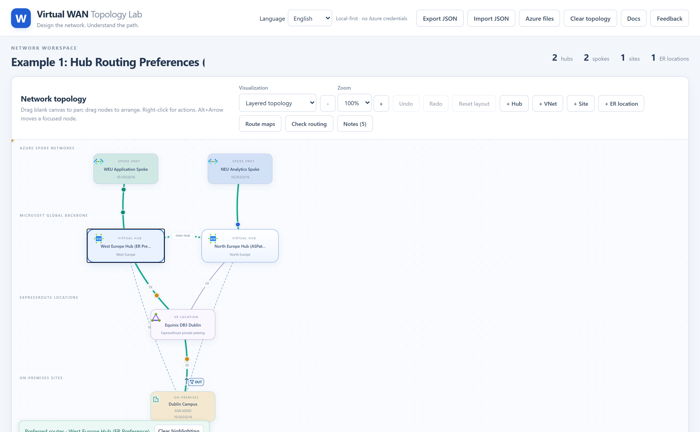
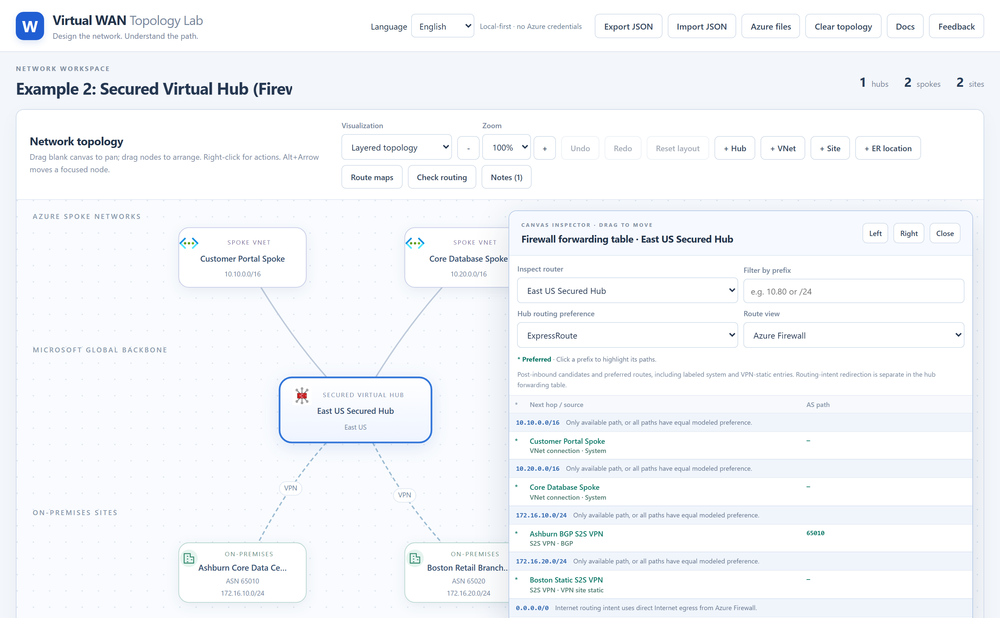
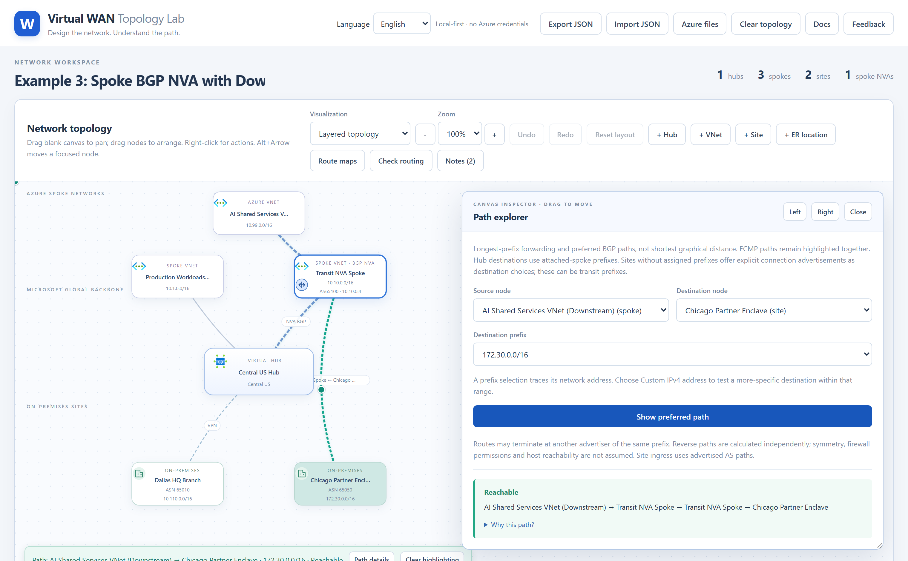
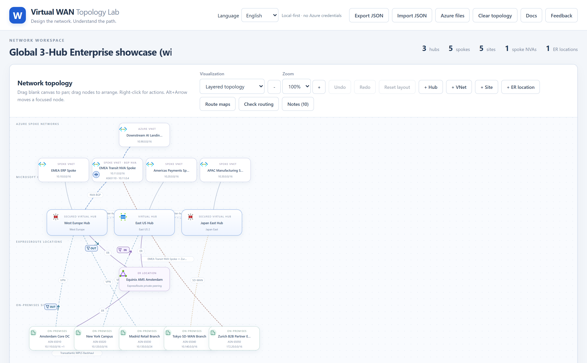
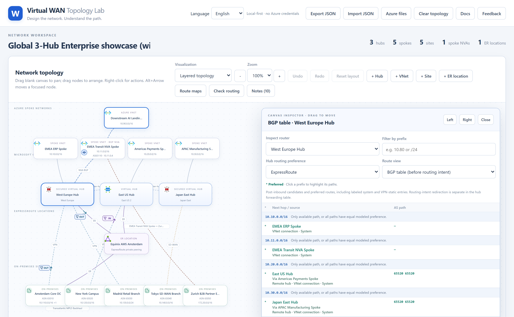
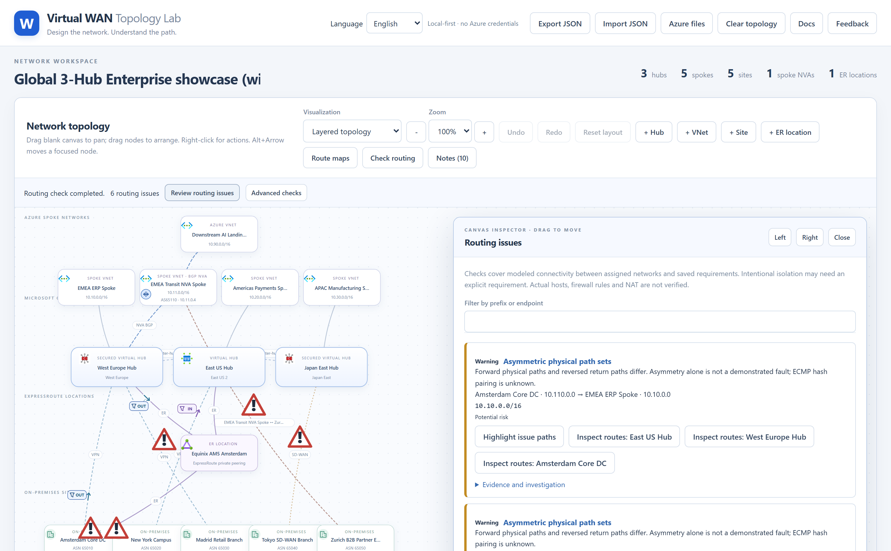
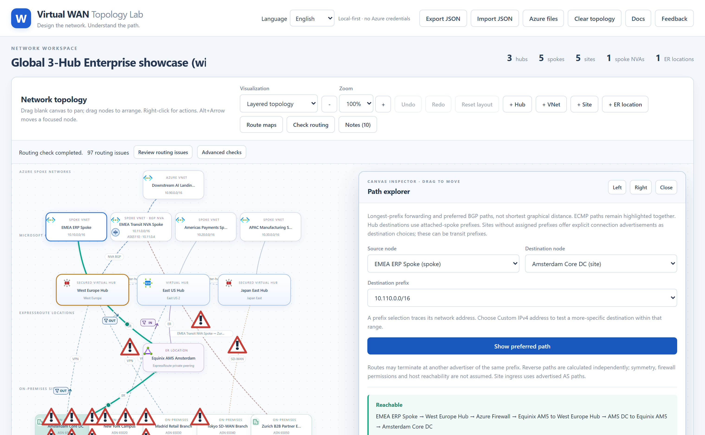
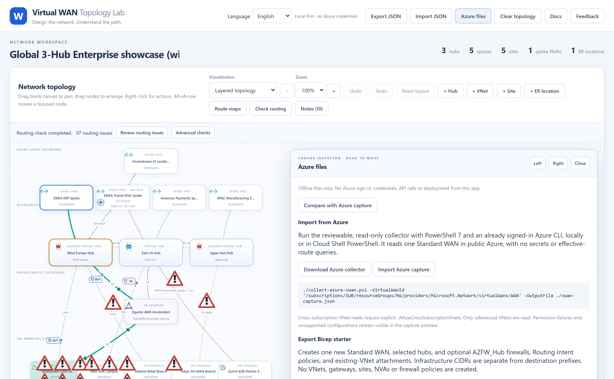

# Virtual WAN トポロジ ラボ — ユーザー ガイドと実践サンプル

**言語 / Language:** [English](./README.md) | **日本語**  
**ライブ アプリケーション:** [https://vwan-simulator.com](https://vwan-simulator.com)  
**インタラクティブ Web ドキュメント (日本語):** [https://vwan-simulator.com/docs/?lang=ja](https://vwan-simulator.com/docs/?lang=ja)

**Virtual WAN トポロジ ラボ (Virtual WAN Topology Lab)** は、ローカル ファーストで動作する説明可能な Azure Virtual WAN トポロジ デザイナーおよびルーティング シミュレーターです。Azure の資格情報は一切不要で、ブラウザー内のみで有効なルート、BGP パス選択、セキュリティで保護された仮想ハブ (Secured Virtual Hub) のルーティング インテント、ルート マップ、スポーク BGP NVA トランジット、およびペアワイズ ルーティング診断をリアルタイムに計算・可視化します。

---

## 目次

1. [基本的な使い方（ステップバイステップ）](#1-基本的な使い方ステップバイステップ)
2. [ダウンロード可能なサンプル JSON トポロジ](#2-ダウンロード可能なサンプル-json-トポロジ)
3. [サンプル 1: ハブのルーティングの優先順位 (`ExpressRoute` vs `VPN` vs `ASPath`)](#3-サンプル-1-ハブのルーティングの優先順位-expressroute-vs-vpn-vs-aspath)
4. [サンプル 2: セキュリティで保護された仮想ハブと Azure Firewall ルーティング インテント](#4-サンプル-2-セキュリティで保護された仮想ハブと-azure-firewall-ルーティング-インテント)
5. [サンプル 3: スポーク BGP NVA によるダウンストリーム VNet・パートナー サイトへのトランジット](#5-サンプル-3-スポーク-bgp-nva-によるダウンストリーム-vnetパートナー-サイトへのトランジット)
6. [サンプル 4: 3 ハブ全機能エンタープライズ ショーケース（非対称ルーティングを含む）](#6-サンプル-4-3-ハブ全機能エンタープライズ-ショーケース非対称ルーティングを含む)
7. [有効なルート、パス エクスプローラー、自動ルーティング診断の確認](#7-有効なルートパス-エクスプローラー自動ルーティング診断の確認)
8. [Azure Bicep エクスポートと実環境スナップショット比較](#8-azure-bicep-エクスポートと実環境スナップショット比較)

---

## 1. 基本的な使い方（ステップバイステップ）

1. **トポロジ オブジェクトの追加**: ワークスペース ツールバーのボタン（`+ ハブ`、`+ VNet`、`+ サイト`、`+ ER ピアリングの場所`）を使用するか、キャンバスの空白部分を右クリックして、Virtual WAN ハブ、スポーク VNet、オンプレミス サイト、および ExpressRoute ピアリングの場所を追加します。
2. **接続とルーティング ポリシーの構成**: キャンバス上の任意のノードまたはリンクを右クリックしてコンテキスト メニューを開きます。
   - **仮想ハブ**: ハブのルーティングの優先順位（`ExpressRoute`、`VPN`、または `ASPath`）の設定、**セキュリティで保護された仮想ハブ** の Azure Firewall ルーティング インテント（プライベート トラフィック / インターネット トラフィック）の有効化、**BGP テーブル** / **学習したルート** / **アドバタイズしたルート** / **ファイアウォールのルートを表示** の確認、または **優先ルートを強調表示** を実行できます。
   - **スポーク VNet**: **BGP NVA を追加** したり、NVA の背後にスタンドアロン Azure VNet やダウンストリームのオンプレミス サイトを接続したり、スポーク接続のルート マップを構成したりできます。
   - **オンプレミス サイト**: **ExpressRoute**、**VPN**（BGP または静的）、または **SD-WAN** でハブに接続したり、サイト間 WAN リンクを追加したり、サイトのルート マップや静的ルーティング テーブルを構成したりできます。ハブとサイトの間に **ExpressRoute** 接続を追加すると、ExpressRoute ピアリングの場所が自動的に作成されます。
3. **強調表示と警告アイコンのクリア**: キャンバス上にパスの強調表示やルーティング診断の警告アイコンが表示されている場合は、キャンバス左下の **強調表示とアイコンをクリア (Clear highlights & icons)** ボタンをクリックすると一括で消去できます。
4. **JSON トポロジの保存・共有・読み込み**: 上部バーの **JSON をエクスポート (Export JSON)** をクリックしてトポロジをポータブルな `.json` ファイルとして保存するか、**JSON をインポート (Import JSON)** をクリックして保存済みのトポロジを読み込みます。

---

## 2. ダウンロード可能なサンプル JSON トポロジ

本ガイドのすべてのスクリーンショットは、以下のサンプル JSON ファイルから直接キャプチャされています。`.json` ファイルをダウンロードして **JSON をインポート** から読み込むか、**シミュレーターで開く** をクリックして `vwan-simulator.com` で即座に開くことができます。

| サンプル | シナリオ | サンプル JSON ファイル | ワンクリック起動 |
| :--- | :--- | :--- | :--- |
| **サンプル 1** | ハブのルーティングの優先順位 (`ExpressRoute` vs `ASPath`) | [`hub-routing-preferences.json`](../samples/hub-routing-preferences.json) | [シミュレーターで開く](https://vwan-simulator.com/?sample=hub-routing-preferences) |
| **サンプル 2** | セキュリティで保護された仮想ハブとルーティング インテント | [`secured-hub-routing-intent.json`](../samples/secured-hub-routing-intent.json) | [シミュレーターで開く](https://vwan-simulator.com/?sample=secured-hub-routing-intent) |
| **サンプル 3** | スポーク BGP NVA トランジット（ダウンストリーム VNet + パートナー拠点） | [`spoke-bgp-nva-transit.json`](../samples/spoke-bgp-nva-transit.json) | [シミュレーターで開く](https://vwan-simulator.com/?sample=spoke-bgp-nva-transit) |
| **サンプル 4** | 3 ハブ全機能ショーケース（非対称ルーティングを含む） | [`three-hub-all-features-asymmetric.json`](../samples/three-hub-all-features-asymmetric.json) | [シミュレーターで開く](https://vwan-simulator.com/?sample=three-hub-all-features-asymmetric) |

---

## 3. サンプル 1: ハブのルーティングの優先順位 (`ExpressRoute` vs `VPN` vs `ASPath`)

- **サンプル JSON:** [`samples/hub-routing-preferences.json`](../samples/hub-routing-preferences.json)
- **ライブ リンク:** [https://vwan-simulator.com/?sample=hub-routing-preferences](https://vwan-simulator.com/?sample=hub-routing-preferences)

このシナリオでは、**Dublin Campus**（`10.50.0.0/16`、ASN `65050`）が **ExpressRoute**（アウトバウンド ルート マップで `65050 65050` をプリペンドし、AS パス長が 3 ホップ）と **BGP S2S VPN**（1 ホップ）の両方で 2 つの Virtual WAN ハブに同一プレフィックスをアドバタイズしています。

- **West Europe Hub (ER Preference)** はハブのルーティングの優先順位が `ExpressRoute` のため、AS パスが 3 ホップであっても `10.50.0.0/16` への経路として **ExpressRoute** を選択します。
- **North Europe Hub (ASPath Preference)** はハブのルーティングの優先順位が `ASPath` のため、1 ホップの **BGP S2S VPN** 経路を選択します。



---

## 4. サンプル 2: セキュリティで保護された仮想ハブと Azure Firewall ルーティング インテント

- **サンプル JSON:** [`samples/secured-hub-routing-intent.json`](../samples/secured-hub-routing-intent.json)
- **ライブ リンク:** [https://vwan-simulator.com/?sample=secured-hub-routing-intent](https://vwan-simulator.com/?sample=secured-hub-routing-intent)

このシナリオでは、**プライベート トラフィック**（`10.0.0.0/8`、`172.16.0.0/12`）と **インターネット トラフィック**（`0.0.0.0/0`）の両方で Azure Firewall ルーティング インテントを有効化した **East US Secured Hub** をモデル化しています。

- スポーク間、スポーク・ブランチ間、およびインターネット宛てのトラフィックはすべて **Azure Firewall** を経由します。
- **Boston Retail Branch** は `既定ルートの伝達 (0.0.0.0/0)` を有効化した **静的 S2S VPN** で接続し、Secured Hub から `0.0.0.0/0` を学習します。



---

## 5. サンプル 3: スポーク BGP NVA によるダウンストリーム VNet・パートナー サイトへのトランジット

- **サンプル JSON:** [`samples/spoke-bgp-nva-transit.json`](../samples/spoke-bgp-nva-transit.json)
- **ライブ リンク:** [https://vwan-simulator.com/?sample=spoke-bgp-nva-transit](https://vwan-simulator.com/?sample=spoke-bgp-nva-transit)

**Central US Hub** は、**Transit NVA Spoke**（`10.10.0.0/16`）内のネットワーク仮想アプライアンス（`10.10.0.4`、ASN `65100`）と BGP ピアリングしています。この NVA は以下の両方へのトランジットを提供します。
- **AI Shared Services VNet (Downstream)**（`10.99.0.0/16`）— Virtual WAN に直接接続せず、NVA スポークにピアリングされたスタンドアロン Azure VNet。
- **Chicago Partner Enclave**（`172.30.0.0/16`、ASN `65050`）— NVA に収容されたダウンストリームのオンプレミス パートナー サイト。



---

## 6. サンプル 4: 3 ハブ全機能エンタープライズ ショーケース（非対称ルーティングを含む）

- **サンプル JSON:** [`samples/three-hub-all-features-asymmetric.json`](../samples/three-hub-all-features-asymmetric.json)
- **ライブ リンク:** [https://vwan-simulator.com/?sample=three-hub-all-features-asymmetric](https://vwan-simulator.com/?sample=three-hub-all-features-asymmetric)

この 3 ハブ構成のエンタープライズ トポロジは、**West Europe Hub**（Secured、`ExpressRoute` 優先）、**East US Hub**（`VPN` 優先）、**Japan East Hub**（Secured、`ASPath` 優先）と、ExpressRoute、BGP VPN、静的 VPN、SD-WAN、スポーク BGP NVA、オンプレミス サイト間 WAN リンク、インバウンド / アウトバウンド ルート マップを組み合わせています。

また、Azure スポークと **Amsterdam Core DC**（`10.100.0.0/16`）の間に意図的な **非対称ルーティング** が含まれています。
- **往路（`EMEA ERP Spoke` → `Amsterdam Core DC`）**: `West Europe Hub` が `ExpressRoute` を優先するため、**ExpressRoute**（`Equinix AM5 Amsterdam`）を通ります。
- **復路（`Amsterdam Core DC` → `EMEA ERP Spoke`）**: `West Europe Hub` の ExpressRoute リンクに適用されたアウトバウンド ルート マップ `WEU-ER-Out-Prepend`（`64496 64496`）により、ExpressRoute 経由の AS パスが 3 ホップ（`65515 64496 64496`）になる一方、バックアップの BGP VPN リンクは 1 ホップ（`65515`）のままとなるため、復路は **BGP VPN** を通ります。



---

## 7. 有効なルート、パス エクスプローラー、自動ルーティング診断の確認

### 有効なルートと BGP テーブル インスペクター
任意のハブ、サイト、または ExpressRoute ピアリングの場所を右クリックし、**BGP テーブル (BGP table)**、**学習したルート (Learned routes)**、または **アドバタイズしたルート (Advertised routes)** を選択すると、すべての候補ルート、AS パス、および選択理由（タイブレーカー）を確認できます。



### 自動ルーティング診断（非対称パスの検出）
ツールバーの **ルーティングを診断 (Check routing)** をクリックし、続いて **ルーティングの問題を確認 (Review routing issues)** を開くと、Azure スポークと **Amsterdam Core DC** 間の非対称パスなどの根本原因が確認できます。



### インタラクティブなパス エクスプローラー
任意のノードを右クリックして **パス エクスプローラーを開く (Open path explorer)** を選択すると、送信元から宛先へのフローを追跡し、ホップごとの詳細な選択理由を確認できます。



---

## 8. Azure Bicep エクスポートと実環境スナップショット比較

上部バーの **Azure ファイル (Azure files)** をクリックすると、以下の機能を利用できます。
- **デプロイ可能な Azure Bicep テンプレート (`.bicep`) のダウンロード**: モデル化したトポロジを Bicep ファイルとして出力します。
- **読み取り専用 PowerShell Azure CLI 収集スクリプト ([`scripts/collect-azure-vwan.ps1`](https://github.com/erjosito/vwan-visual-topology-feedback/blob/main/scripts/collect-azure-vwan.ps1)) のダウンロード**: 実際の Azure 環境から Virtual WAN トポロジと有効なルート テーブルを取得します。
  ```powershell
  Invoke-WebRequest -Uri 'https://raw.githubusercontent.com/erjosito/vwan-visual-topology-feedback/main/scripts/collect-azure-vwan.ps1' -OutFile ./collect-azure-vwan.ps1
  ./collect-azure-vwan.ps1 -VirtualWanId '/subscriptions/SUB/resourceGroups/RG/providers/Microsoft.Network/virtualWans/WAN' -IncludeEffectiveRoutes -OutputFile ./vwan-observation.json
  ```
- **実測された Azure ルートとシミュレーション結果の比較**: 取得したスナップショットをインポートし、実環境のルートとシミュレートされたルートを並べて比較できます。


