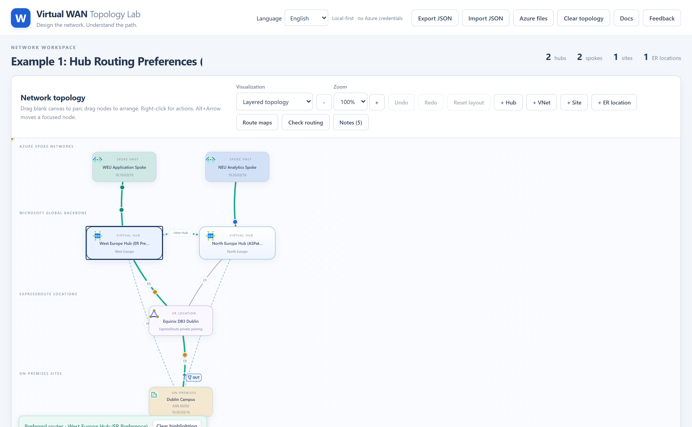
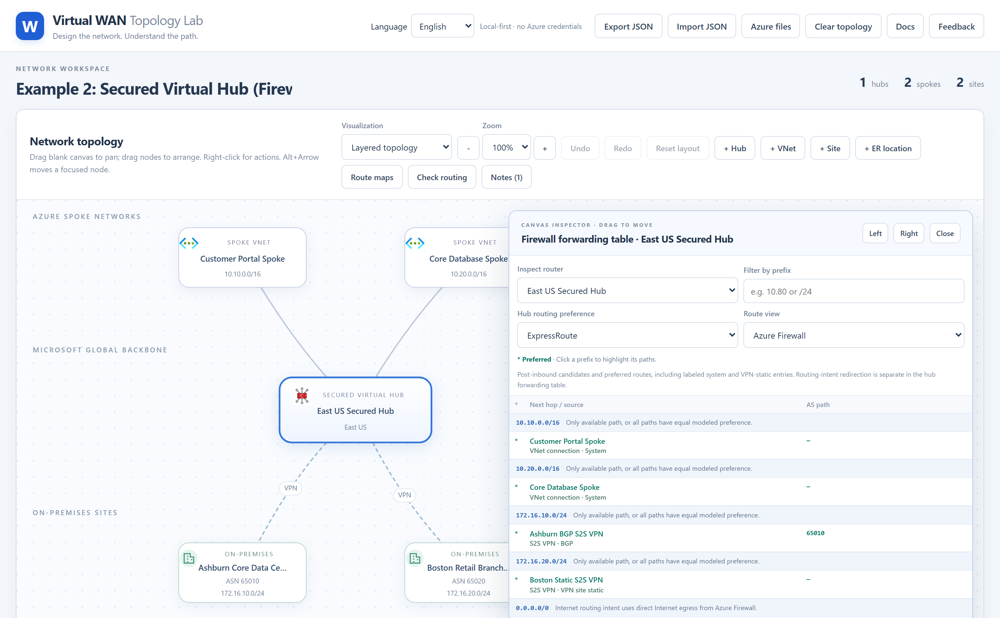
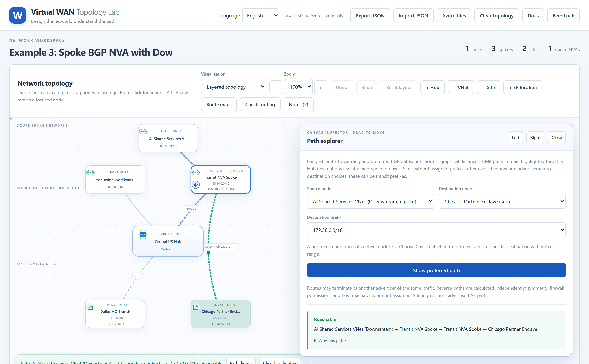
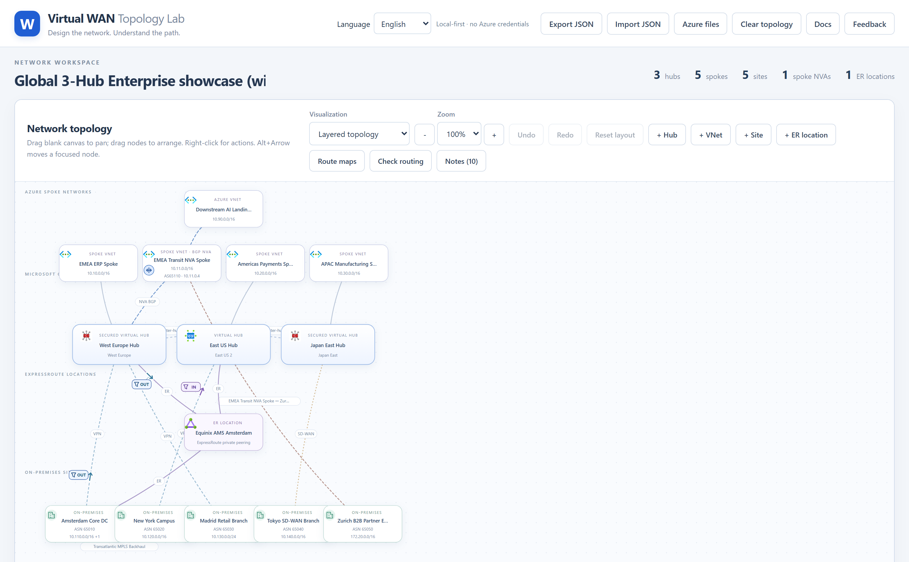
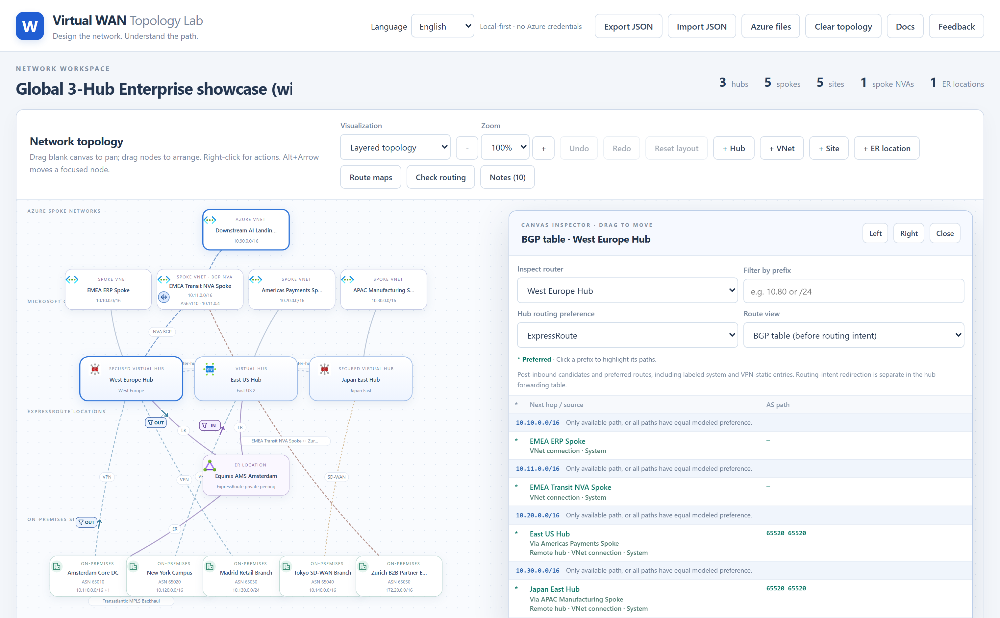
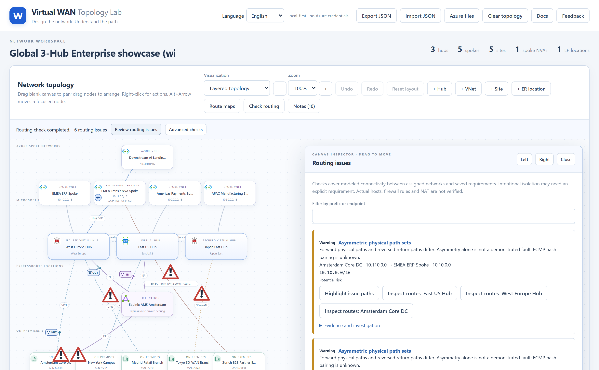
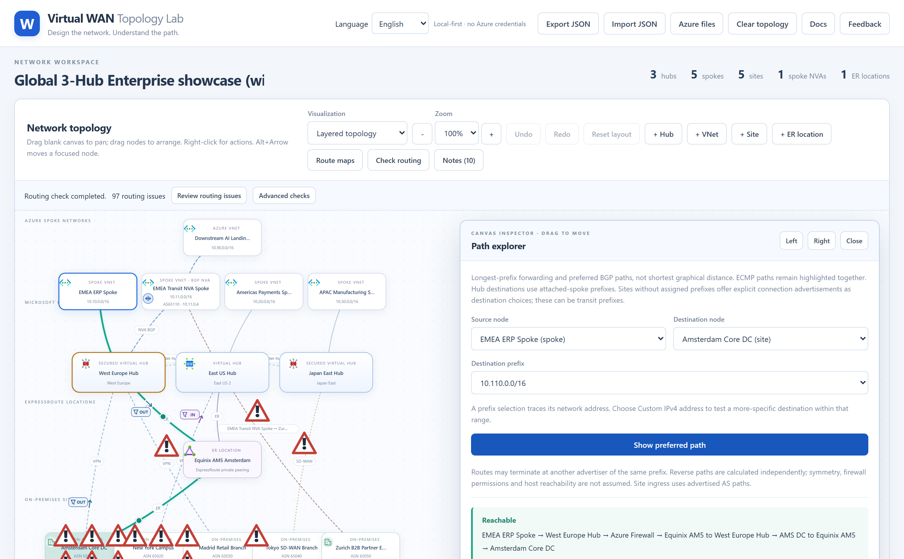
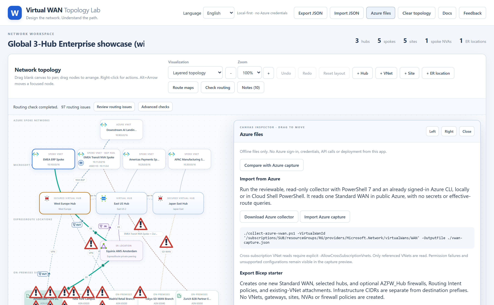

# Azure Network Simulator (AzNetSim): ユーザー ガイドと実践サンプル

**言語 / Language:** [English](./README.md) | **日本語**  
**ライブ アプリケーション:** [https://aznet-simulator.com](https://aznet-simulator.com)

**インタラクティブ Web ドキュメント (日本語):** [https://aznet-simulator.com/docs/?lang=ja](https://aznet-simulator.com/docs/?lang=ja)

**Azure Network Simulator (AzNetSim)** は、クラシック Azure VNet、ハブ＆スポーク、Virtual WAN、ハイブリッド／オンプレミス ネットワークを対象とする、ローカル ファーストのトポロジ デザイナー兼説明可能な計画用シミュレーターです。ブラウザー版と Windows デスクトップ版は共通のシミュレーション基盤を使用し、シミュレーションに Azure の資格情報は不要です。有効なルート、BGP／UDR、Route Server、Firewall／NVA の経路、対応するパケット フローを確認できます。実際の Azure コントロール プレーンやパケット配信を保証するものではありません。

以下の実践サンプルは、AzNetSim の一部である **Virtual WAN** を中心に説明します。クラシック VNet と混在構成は[サンプル カタログ（英語）](./sample-catalog.md)、[Azure VNet サンプル](../samples/README.ja.md)、[現在の対応範囲と制限（英語）](../README.md#scope)を参照してください。`vwan-simulator.com` と既存のファイル／リンクは引き続き利用できます。保存データは Web サイトのオリジンごとに独立しています。

---

## 目次

1. [基本的な使い方（ステップバイステップ）](#1-基本的な使い方ステップバイステップ)
2. [ダウンロード可能なサンプル JSON トポロジ](#2-ダウンロード可能なサンプル-json-トポロジ)
3. [サンプル 1: ハブのルーティングの優先順位 (`ExpressRoute` vs `VPN` vs `ASPath`)](#3-サンプル-1-ハブのルーティングの優先順位-expressroute-vs-vpn-vs-aspath)
4. [サンプル 2: セキュリティで保護された仮想ハブと Azure Firewall ルーティング インテント](#4-サンプル-2-セキュリティで保護された仮想ハブと-azure-firewall-ルーティング-インテント)
5. [サンプル 3: スポーク BGP NVA によるダウンストリーム VNet・パートナー サイトへのトランジット](#5-サンプル-3-スポーク-bgp-nva-によるダウンストリーム-vnetパートナー-サイトへのトランジット)
6. [サンプル 4: 3 ハブ全機能エンタープライズ ショーケース（非対称ルーティングを含む）](#6-サンプル-4-3-ハブ全機能エンタープライズ-ショーケース非対称ルーティングを含む)
7. [有効なルート、パス エクスプローラー、自動ルーティング診断の確認](#7-有効なルートパス-エクスプローラー自動ルーティング診断の確認)
8. [Azure Bicep エクスポートと実環境スナップショット比較](#8-azure-bicep-エクスポートと実環境スナップショット比較)
9. [現在のワークスペースとモデル](#9-現在のワークスペースとモデル)
10. [ローカル MCP の設定](#10-ローカル-mcp-の設定)

---

## 1. 基本的な使い方（ステップバイステップ）

新しい UI が既定です。**従来の UI を使用**で、設計を変更せずに以前の表示に戻せます。
**設定**にはテーマ、言語、キャンバスと接続線のスタイルをまとめています。
**ヘルプ**には**ドキュメント**と**フィードバック**を配置し、
表示設定と支援機能を分けています。デスクトップ版は同梱のオフライン ガイドを開き、
フィードバック送信は無効のままです。ズーム、表示の調整・リセット、レイアウトの操作は
キャンバスのそばに残しています。**Checks（診断）**には**ルーティングを診断**と
**詳細な診断**をまとめ、結果と警告はワークスペースに表示します。

主な操作は 1 行の **Tools**、**Learn**、**Explore**、**Checks**、**File**、
**Azure**、**Settings**、**Help** です。アカウントと帯は別の操作で、タブと保存状態も
独立しています。狭いウィンドウでは**ワークスペースの操作**から補助コマンドを開きます。
空のキャンバスのリソース追加、設計を開く、サンプル読み込みは非表示にでき、
リソース追加後は消えます。選択時の構成、ルート、追跡、接続操作は選択を保持して
最小化できます。すべての操作は検索可能なツール ドロワーを開き、右クリックも利用できます。

混在ネットワークのインスペクターでは、オンプレミス サイトの広告プレフィックスと ASN、
VNet のアドレス空間の一覧は、フィールドの外をクリックするか Tab キーで移動すると保存されます。
入力中のカンマや空白は保持されます。サイトの一覧を空にすると、その広告プレフィックスを撤回します。
名前は引き続き即座に更新されます。従来の Virtual WAN 構成ダイアログでは、**変更を保存**を使用します。

Web 版では、**ヘルプ > Windows アプリ**から [Microsoft Store の製品ページ](https://apps.microsoft.com/detail/9P76BP1MXWZ2)を、
**ヘルプ > MCP サーバー**からローカル MCP のセットアップ ガイドを開けます。
リンクはヘルプ内にあり、空のキャンバスには表示しません。現在のデザインは変更しません。

1. **ワークスペースを開く**: 新規セッションは空の混在ネットワークから始まります。**ワークスペース (Workspace)** で保存済み設計を開いたり、新規作成したりできます。アーキテクチャ モードの選択は不要で、クラシック VNet と Virtual WAN ハブを同じ設計に配置できます。従来の Virtual WAN ファイルとサンプルは、互換性のあるエディターでそのまま開きます。
2. **トポロジ オブジェクトの追加**: ワークスペースのコンテキストに応じた操作、またはキャンバスの空白部分の右クリックから、Virtual WAN ハブ、スポーク/ハブ VNet、オンプレミス サイト、および ExpressRoute ピアリングの場所を追加します。
3. **ノードへのカスタム テキスト ラベル（任意）の追加**: すべてのノード（ハブ、スポーク/VNet、ExpressRoute ピアリングの場所、オンプレミス サイト）に、図上にピル型バッジとして表示される任意の `label`（最大 120 文字）を設定できます。
   - 選択したオブジェクトの設定ダイアログまたはインスペクターで編集します。従来の Virtual WAN オブジェクトでは、**構成を編集 (Edit configuration)** → **ラベル（任意・図に表示）** を使用します。
4. **接続とルーティング ポリシーの構成**: キャンバス上の任意のノードまたはリンクを右クリックしてコンテキスト メニューを開きます。
   - **仮想ハブ**: ハブのルーティングの優先順位（`ExpressRoute`、`VPN`、または `ASPath`）の設定、**セキュリティで保護された仮想ハブ** の Azure Firewall ルーティング インテント（プライベート トラフィック / インターネット トラフィック）の有効化、**BGP テーブル** / **学習したルート** / **アドバタイズしたルート** / **ファイアウォールのルートを表示** の確認、または **優先ルートを強調表示** を実行できます。
   - **スポーク VNet**: **BGP NVA を追加** したり、NVA の背後にスタンドアロン Azure VNet やダウンストリームのオンプレミス サイトを接続したり、スポーク接続のルート マップを構成したりできます。
   - **オンプレミス サイト**: **ExpressRoute**、**VPN**（BGP または静的）、または **SD-WAN** でハブに接続したり、サイト間 WAN リンクを追加したり、サイトのルート マップや静的ルーティング テーブルを構成したりできます。ハブとサイトの間に **ExpressRoute** 接続を追加すると、ExpressRoute ピアリングの場所が自動的に作成されます。
5. **強調表示と警告アイコンのクリア**: キャンバス上にパスの強調表示やルーティング診断の警告アイコンが表示されている場合は、キャンバス左下の **強調表示とアイコンをクリア (Clear highlights & icons)** ボタンをクリックすると一括で消去できます。
6. **保存と読み込み**: **読み込み (Load)**、**保存 (Save)**、**名前を付けて保存 (Save As)** を使用します。復元用コピーは JSON バックアップではありません。Web のクラウド保存と読み取り専用共有は別の確認操作です。既存の `#s=...` は失効できない読み取り専用スナップショットで、新しい全トポロジ URL は生成しません。デスクトップでは JSON ファイルを共有します。

---

## 2. ダウンロード可能なサンプル JSON トポロジ

画像はサンプルのシナリオ説明用で古い操作を含む場合があり、現在のコンパクト UI の
確認済みキャプチャではありません。JSON をダウンロードして **読み込み (Load)** で
開くか、シミュレーターで開くを使用します。置換前に現在の設計を保存してください。

| サンプル | シナリオ | サンプル JSON ファイル | ワンクリック起動 |
| :--- | :--- | :--- | :--- |
| **サンプル 1** | ハブのルーティングの優先順位 (`ExpressRoute` vs `ASPath`) | [`hub-routing-preferences.json`](../samples/hub-routing-preferences.json) | [シミュレーターで開く](https://aznet-simulator.com/?sample=hub-routing-preferences) |
| **サンプル 2** | セキュリティで保護された仮想ハブとルーティング インテント | [`secured-hub-routing-intent.json`](../samples/secured-hub-routing-intent.json) | [シミュレーターで開く](https://aznet-simulator.com/?sample=secured-hub-routing-intent) |
| **サンプル 3** | スポーク BGP NVA トランジット（ダウンストリーム VNet + パートナー拠点） | [`spoke-bgp-nva-transit.json`](../samples/spoke-bgp-nva-transit.json) | [シミュレーターで開く](https://aznet-simulator.com/?sample=spoke-bgp-nva-transit) |
| **サンプル 4** | 3 ハブ全機能ショーケース（非対称ルーティングを含む） | [`three-hub-all-features-asymmetric.json`](../samples/three-hub-all-features-asymmetric.json) | [シミュレーターで開く](https://aznet-simulator.com/?sample=three-hub-all-features-asymmetric) |

---

## 3. サンプル 1: ハブのルーティングの優先順位 (`ExpressRoute` vs `VPN` vs `ASPath`)

- **サンプル JSON:** [`samples/hub-routing-preferences.json`](../samples/hub-routing-preferences.json)
- **ライブ リンク:** [https://aznet-simulator.com/?sample=hub-routing-preferences](https://aznet-simulator.com/?sample=hub-routing-preferences)

このシナリオでは、**Dublin Campus**（`10.50.0.0/16`、ASN `65050`）が **ExpressRoute**（アウトバウンド ルート マップで `65050 65050` をプリペンドし、AS パス長が 3 ホップ）と **BGP S2S VPN**（1 ホップ）の両方で 2 つの Virtual WAN ハブに同一プレフィックスをアドバタイズしています。

- **West Europe Hub (ER Preference)** はハブのルーティングの優先順位が `ExpressRoute` のため、AS パスが 3 ホップであっても `10.50.0.0/16` への経路として **ExpressRoute** を選択します。
- **North Europe Hub (ASPath Preference)** はハブのルーティングの優先順位が `ASPath` のため、1 ホップの **BGP S2S VPN** 経路を選択します。



---

## 4. サンプル 2: セキュリティで保護された仮想ハブと Azure Firewall ルーティング インテント

- **サンプル JSON:** [`samples/secured-hub-routing-intent.json`](../samples/secured-hub-routing-intent.json)
- **ライブ リンク:** [https://aznet-simulator.com/?sample=secured-hub-routing-intent](https://aznet-simulator.com/?sample=secured-hub-routing-intent)

このシナリオでは、**プライベート トラフィック**（`10.0.0.0/8`、`172.16.0.0/12`）と **インターネット トラフィック**（`0.0.0.0/0`）の両方で Azure Firewall ルーティング インテントを有効化した **East US Secured Hub** をモデル化しています。

- スポーク間、スポーク・ブランチ間、およびインターネット宛てのトラフィックはすべて **Azure Firewall** を経由します。
- **Boston Retail Branch** は `既定ルートの伝達 (0.0.0.0/0)` を有効化した **静的 S2S VPN** で接続し、Secured Hub から `0.0.0.0/0` を学習します。



---

## 5. サンプル 3: スポーク BGP NVA によるダウンストリーム VNet・パートナー サイトへのトランジット

- **サンプル JSON:** [`samples/spoke-bgp-nva-transit.json`](../samples/spoke-bgp-nva-transit.json)
- **ライブ リンク:** [https://aznet-simulator.com/?sample=spoke-bgp-nva-transit](https://aznet-simulator.com/?sample=spoke-bgp-nva-transit)

**Central US Hub** は、**Transit NVA Spoke**（`10.10.0.0/16`）内のネットワーク仮想アプライアンス（`10.10.0.4`、ASN `65100`）と BGP ピアリングしています。この NVA は以下の両方へのトランジットを提供します。
- **AI Shared Services VNet (Downstream)**（`10.99.0.0/16`）— Virtual WAN に直接接続せず、NVA スポークにピアリングされたスタンドアロン Azure VNet。
- **Chicago Partner Enclave**（`172.30.0.0/16`、ASN `65050`）— NVA に収容されたダウンストリームのオンプレミス パートナー サイト。



---

## 6. サンプル 4: 3 ハブ全機能エンタープライズ ショーケース（非対称ルーティングを含む）

- **サンプル JSON:** [`samples/three-hub-all-features-asymmetric.json`](../samples/three-hub-all-features-asymmetric.json)
- **ライブ リンク:** [https://aznet-simulator.com/?sample=three-hub-all-features-asymmetric](https://aznet-simulator.com/?sample=three-hub-all-features-asymmetric)

この 3 ハブ構成のエンタープライズ トポロジは、**West Europe Hub**（Secured、`ExpressRoute` 優先）、**East US Hub**（`VPN` 優先）、**Japan East Hub**（Secured、`ASPath` 優先）と、ExpressRoute、BGP VPN、静的 VPN、SD-WAN、スポーク BGP NVA、オンプレミス サイト間 WAN リンク、インバウンド / アウトバウンド ルート マップを組み合わせています。

また、Azure スポークと **Amsterdam Core DC**（`10.100.0.0/16`）の間に意図的な **非対称ルーティング** が含まれています。
- **往路（`EMEA ERP Spoke` → `Amsterdam Core DC`）**: `West Europe Hub` が `ExpressRoute` を優先するため、**ExpressRoute**（`Equinix AM5 Amsterdam`）を通ります。
- **復路（`Amsterdam Core DC` → `EMEA ERP Spoke`）**: `West Europe Hub` の ExpressRoute リンクに適用されたアウトバウンド ルート マップ `WEU-ER-Out-Prepend`（`64496 64496`）により、ExpressRoute 経由の AS パスが 3 ホップ（`65515 64496 64496`）になる一方、バックアップの BGP VPN リンクは 1 ホップ（`65515`）のままとなるため、復路は **BGP VPN** を通ります。



---

## 7. 有効なルート、パス エクスプローラー、自動ルーティング診断の確認

### 有効なルートと BGP テーブル インスペクター
任意のハブ、サイト、または ExpressRoute ピアリングの場所を右クリックし、**BGP テーブル (BGP table)**、**学習したルート (Learned routes)**、または **アドバタイズしたルート (Advertised routes)** を選択すると、すべての候補ルート、AS パス、および選択理由（タイブレーカー）を確認できます。



### 自動ルーティング診断（非対称パスの検出）
**Checks > ルーティングを診断 (Check routing)**、続いて **ルーティングの問題を確認 (Review routing issues)** を開き、Azure スポークと **Amsterdam Core DC** 間のモデル化した非対称パスを確認します。範囲と完了を確認し、中断や未評価を問題なしと解釈しないでください。



### 確認済みの警告
対象の警告で **警告を確認済みにする** を選ぶと、重要度、ルーティング、
学習の採点、診断の根拠を変更せず、その警告による要確認の装飾だけを解除します。
**確認済みの警告** は未確認の診断の後に表示され、説明や追跡操作も利用できます。
**要確認に戻す** で個別に戻せます。**すべての警告を要確認に戻す** は、
現在の結果にない警告の保存状態も解除します。エラー、接続失敗、情報、
未評価やモデル制限の結果は確認済みにできません。

状態は設計の省略可能な `warningAcknowledgements` に保存され、
ローカル自動保存、JSON の入出力、クラウド保存、元に戻す・やり直すに引き継がれます。
アカウントや共通の診断プロファイルには保存されず、新しい設計には引き継がれません。
同じ根拠での再診断では維持されますが、関連する構成や経路の根拠が変わると再び要確認になります。
表示名、翻訳、レイアウト、グループ内の順序には依存しません。
同じリソースの別の設定変更でも、安全側の判断で再確認が必要になる場合があります。
最大 4096 件を保持でき、既存の確認状態を解除すると空きを作れます。
この項目のない既存ファイルも利用できます。ピアリング経路のバイパスを示す情報メッセージを
警告に格上げするものではありません。

### インタラクティブなパス エクスプローラー
任意のノードを右クリックして **パス エクスプローラーを開く (Open path explorer)** を選択すると、送信元から宛先へのフローを追跡し、ホップごとの詳細な選択理由を確認できます。



---

## 8. Azure Bicep エクスポートと実環境スナップショット比較

**Azure** から適用可能な **Azure files** または **Azure & Bicep** パネルを開きます。
- **限定的な Bicep スターター (`.bicep`) のダウンロード**: 対応リソースを出力します。前提条件と未出力項目を確認してください。完全な本番デプロイではなく、VWAN 接続スターターは既存 VNet を変更しません。
- **読み取り専用 PowerShell Azure CLI 収集スクリプト ([`scripts/collect-azure-vwan.ps1`](https://github.com/erjosito/vwan-visual-topology-feedback/blob/main/scripts/collect-azure-vwan.ps1)) のダウンロード**: 実際の Azure 環境から Virtual WAN トポロジと有効なルート テーブルを取得します。
  ```powershell
  Invoke-WebRequest -Uri 'https://raw.githubusercontent.com/erjosito/vwan-visual-topology-feedback/main/scripts/collect-azure-vwan.ps1' -OutFile ./collect-azure-vwan.ps1
  ./collect-azure-vwan.ps1 -VirtualWanId '/subscriptions/SUB/resourceGroups/RG/providers/Microsoft.Network/virtualWans/WAN' -IncludeEffectiveRoutes -OutputFile ./vwan-observation.json
  ```
- **記録したルート／フィールドとモデルの比較**: 不足、拒否、古い観測、未対応を明示します。継続的ライブ監視ではありません。

Windows では必要なツールが既にインストールされている場合に、ローカル読み取り専用
Azure CLI 収集を明示的に使用できます。資格情報はキャンバス レンダラーに渡しません。
不一致の報告はトポロジ、証拠、再現情報をローカル ZIP に出力し、自動アップロードしません。
アドレス、リソース ID、メモ、元の収集メタデータは匿名化しません。
[Azure ファイルと再現バンドル（英語）](./azure-files.md)を参照してください。



## 9. 現在のワークスペースとモデル

以下の日本語セクションは Web と同梱 Electron ドキュメントにあります。

| 内容 | ガイド |
| --- | --- |
| 保存、名前を付けて保存、タブ所有権、復元不可 | [保存と復元](https://aznet-simulator.com/docs/?lang=ja#save-recovery) |
| 非公開ライブラリ、GUID 保持バックアップ、共有 | [クラウド](https://aznet-simulator.com/docs/?lang=ja#cloud-backup-sharing) |
| 下書き保持の折りたたみ、インスペクター適用 | [構成](https://aznet-simulator.com/docs/?lang=ja#optional-editors) |
| ゲートウェイ、デュアル ER、独立重複、VPN NAT | [ルーティング](https://aznet-simulator.com/docs/?lang=ja#routing-configuration) |
| ルート、BGP 隣接、診断、警告注意、フロー出力 | [確認と診断](https://aznet-simulator.com/docs/?lang=ja#diagnostics-and-trace) |
| NSG、NAT、LB、Private Link、プライベート プロキシ | [パケット／アプリケーション](https://aznet-simulator.com/docs/?lang=ja#packet-application-scope) |
| 独立練習、改訂版、証拠、カリキュラム実績 | [学習](https://aznet-simulator.com/docs/?lang=ja#learning) |

**保存と復元は別です。** 初回 Save は保存先を選び、以後は確認済み保存先を使用します。
Save As は成功確認後に変更します。詳細で復元用コピー、確認済みファイル、一致するクラウド
を区別します。未確認ダウンロードや保存中に追加した編集は確認済みではありません。
復元が利用不可／別ウィンドウ所有ならファイルに保存または構成済みクラウドに保存を使用し、
閉じる前に各変更タブを保存します。下書きを適用し、閉じる際は保存／破棄／キャンセルを選びます。

**クラウド保存は明示操作です。** 個人アカウントと構成が必要で、編集は自動アップロード
しません。バックアップはクラウド保存 GUID とリソース ID を保持します。プレビューでは一致を
スキップし、競合は保持が既定で、上書きは個別確認です。バッチはトランザクションではありません。
共有権限、学習履歴、ファイル権限は含みませんが、JSON 内の秘密情報は削除しません。
Web リンクは 30 日間、最新保存を公開し固定スナップショットではありません。取得済みコピーは
回収できません。Electron は JSON ファイルを共有します。[詳細（英語）](./cloud-accounts.md)。

**非表示でも構成は保持します。** VWAN 任意セクションは入力／下書きと構成要約を保持し、
周囲の警告を隠しません。独立重複 VNet は接続を意味せず直接重複ピアリングは拒否し、
共通トランジットの曖昧性は未評価の場合があります。無効なローカル ゲートウェイでも
リモート トランジットと競合します。Azure の ER 重みは復路サイトを選択しません。

**パケット／アプリケーションは限定モデルです。** NSG と復路はルートと別です。
v2 複数 SNAT は最大 4 NVA、後続ルールは変換後タプル、逆変換は元の変換器への到達後のみです。
承認済み Private Link Service はエンドポイント、1 NAT、Standard 内部 NIC ベース LB を結び、
VNet 全体のトランジットではありません。プライベート Application Gateway TCP と
Standard／Premium Firewall 明示／捕捉プロキシは別々のクライアント／上流接続を扱います。
HTTP Host と非検査 HTTPS SNI の宛先動作は異なります。全フィールドの画面操作を保証しません。
汎用 HTTP、Front Door、実 DNS、TLS 検査、任意追加ルーター合成、容量、可用性は未対応／未評価です。
[契約（英語）](../src/application-capabilities.ts)とインストール済み MCP 情報を参照してください。

## 10. ローカル MCP の設定

[日本語 MCP 設定セクション](https://aznet-simulator.com/docs/?lang=ja#mcp-server)
はオフラインにも同梱し、Node 22 以上、`mcp-v<version>` パッケージ、ソース構築、stdio 設定、
更新を説明します。`get_capabilities` と `get_schema` でインストール済み操作／例を取得し、
先に入力検証、次に明示条件の評価と制限付き証拠確認を行います。Azure デプロイやキャンバス変更
は行いません。AI クライアントは入力／結果をプロバイダーへ送る可能性があり、ローカル MCP は
ホスト Copilot をオフライン化しません。[技術契約（英語）](../PLATFORM.md#local-mcp--copilot-skill)。
