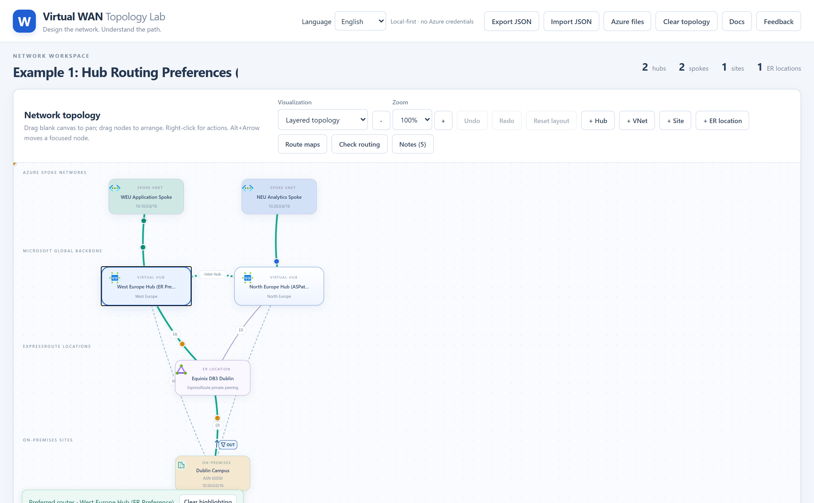
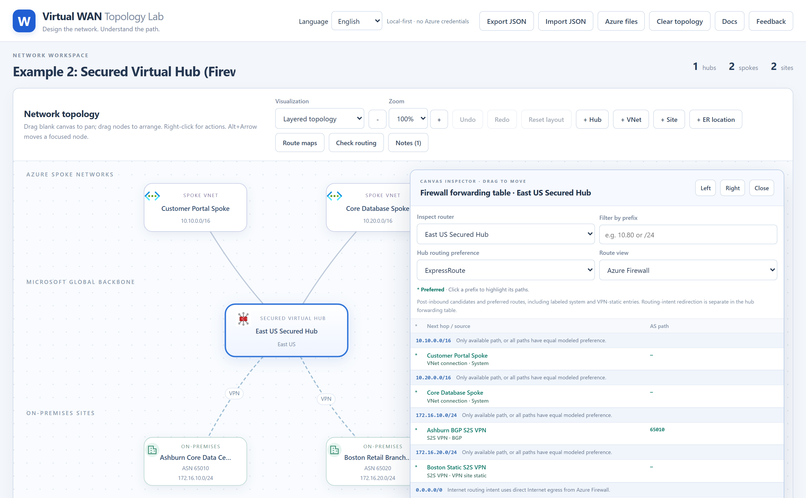
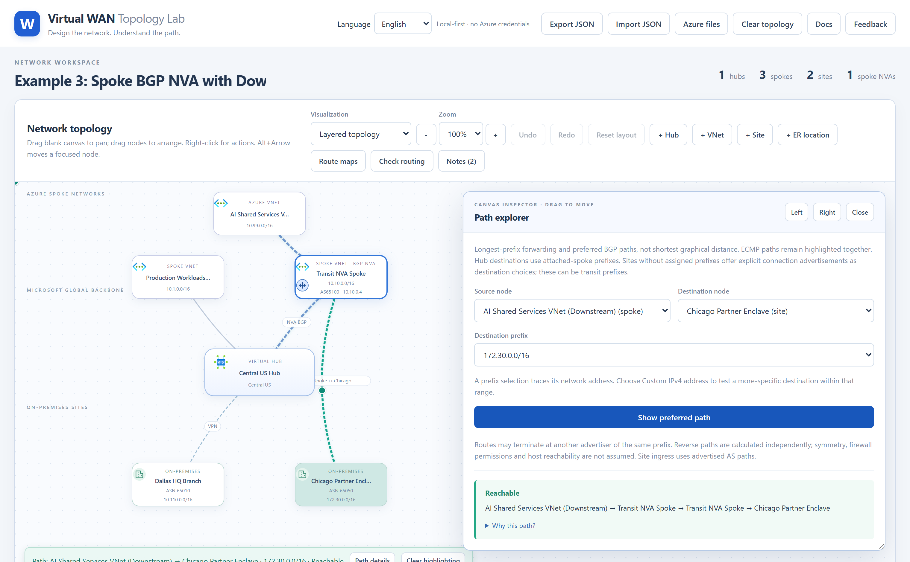
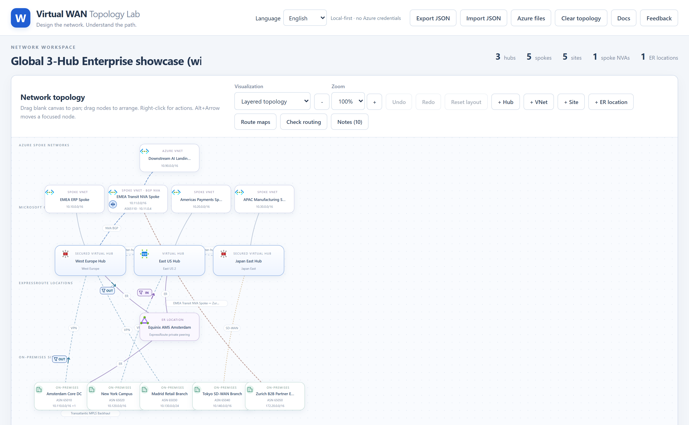
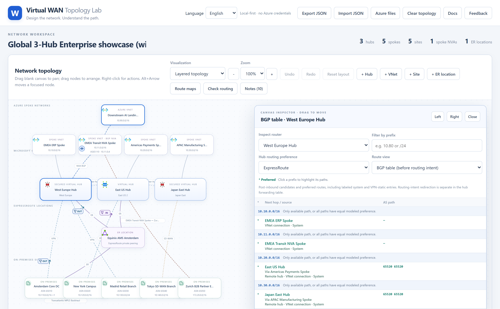
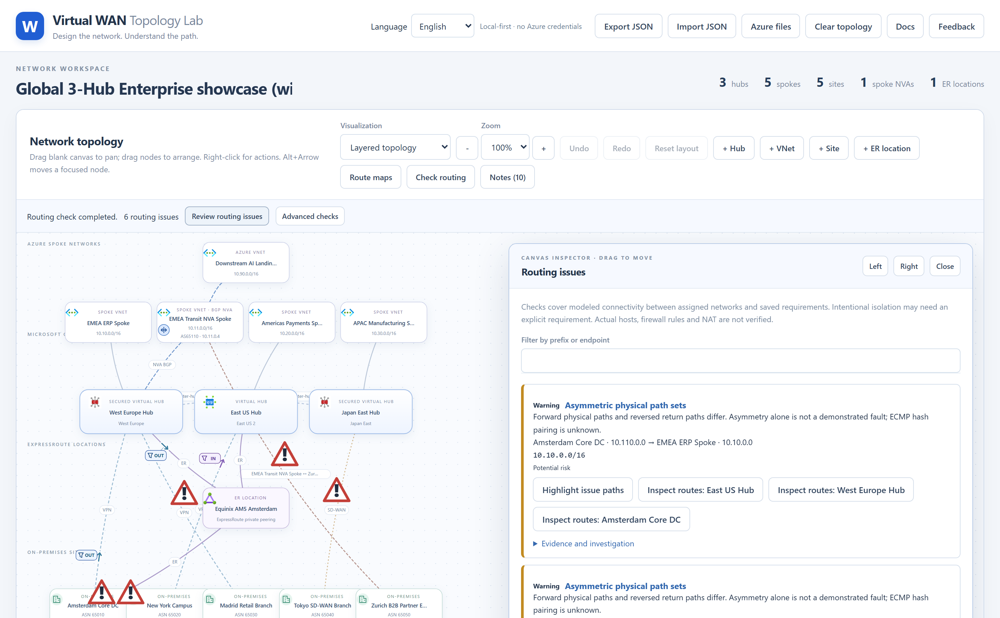
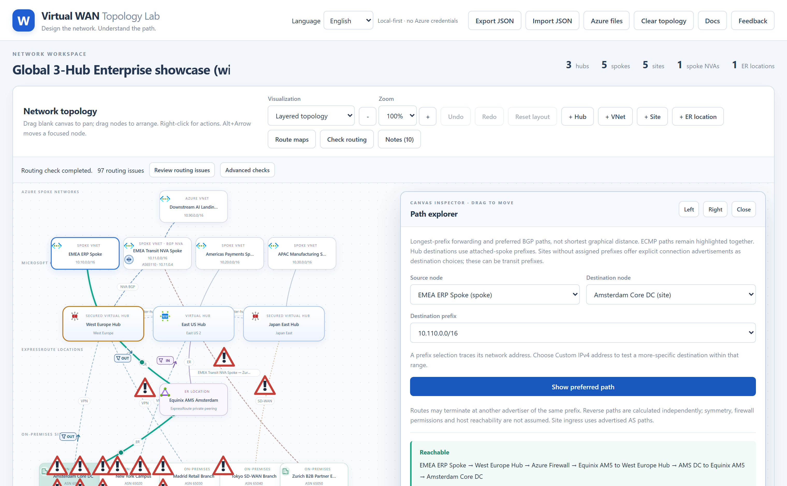
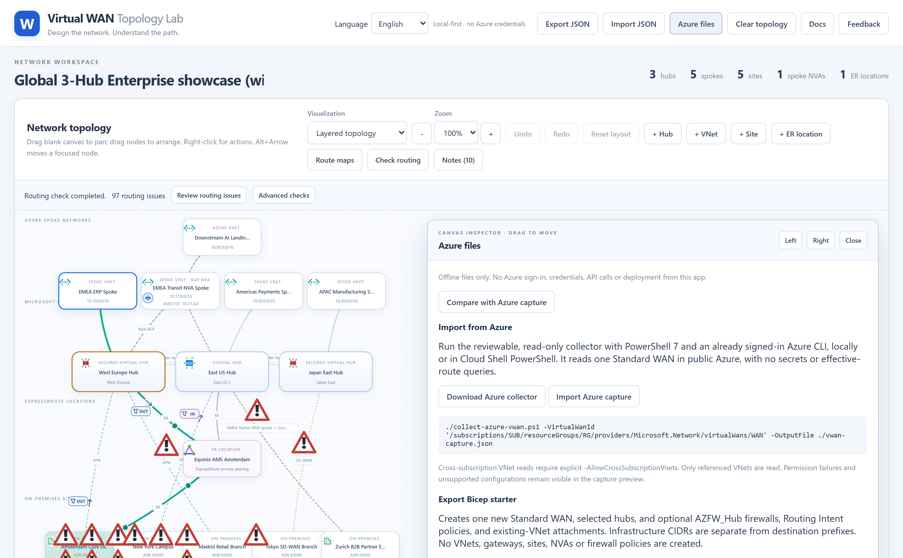

# Virtual WAN Topology Lab — User Guide & Worked Examples

**Live Application:** [https://vwan-simulator.com](https://vwan-simulator.com)  
**Interactive Web Documentation:** [https://vwan-simulator.com/docs/](https://vwan-simulator.com/docs/)

**Virtual WAN Topology Lab** is a local-first, explainable Azure Virtual WAN topology designer and routing simulator. It runs entirely in your browser (with zero Azure credentials required) and calculates effective routes, BGP path selection, Secured Virtual Hub Routing Intent, Route Maps, Spoke BGP NVA transit, and pairwise routing diagnostics in real time.

---

## Table of Contents

1. [Step-by-Step Instructions](#1-step-by-step-instructions)
2. [Downloadable Sample JSON Topologies](#2-downloadable-sample-json-topologies)
3. [Example 1: Hub Routing Preferences (`ExpressRoute` vs `VPN` vs `ASPath`)](#3-example-1-hub-routing-preferences-expressroute-vs-vpn-vs-aspath)
4. [Example 2: Secured Virtual Hub & Azure Firewall Routing Intent](#4-example-2-secured-virtual-hub--azure-firewall-routing-intent)
5. [Example 3: Spoke BGP NVA Transit to Downstream VNet & Partner Site](#5-example-3-spoke-bgp-nva-transit-to-downstream-vnet--partner-site)
6. [Example 4: 3-Hub All-Features Enterprise Showcase (with Asymmetric Routing)](#6-example-4-3-hub-all-features-enterprise-showcase-with-asymmetric-routing)
7. [Inspecting Effective Routes, Path Explorer & Automated Diagnostics](#7-inspecting-effective-routes-path-explorer--automated-diagnostics)
8. [Azure Bicep Export & Observed Snapshot Comparison](#8-azure-bicep-export--observed-snapshot-comparison)

---

## 1. Step-by-Step Instructions

1. **Add Topology Objects**: Use the workspace toolbar buttons (`+ Hub`, `+ VNet`, `+ Site`, `+ ER location`) or right-click blank canvas to add Virtual WAN hubs, spoke VNets, on-premises branch/datacenter sites, and ExpressRoute peering locations.
2. **Configure Connections & Routing Policies**: Right-click any node or link on the canvas to open its context menu:
   - **Virtual Hubs**: Configure the hub routing preference (`ExpressRoute`, `VPN`, or `ASPath`), enable **Secured Virtual Hub** Azure Firewall Routing Intent (Private traffic and/or Internet traffic), inspect the **BGP table** / **Learned routes** / **Advertised routes** / **Firewall routes**, or click **Highlight preferred routes**.
   - **Spoke VNets**: Attach a **BGP NVA**, connect downstream standalone Azure VNets or downstream on-premises sites behind that NVA, or configure spoke connection route maps.
   - **On-Premises Sites**: Connect to hubs via **ExpressRoute**, **VPN** (BGP or Static), or **SD-WAN**; add site-to-site WAN links; or configure site route maps and static routing tables.
3. **Save, Share, or Load JSON Topologies**: Click **Export JSON** in the top bar to save your topology as a portable `.json` file, or click **Import JSON** to load any saved topology.

---

## 2. Downloadable Sample JSON Topologies

Every screenshot in this guide was captured directly from the sample JSON files below. You can either download the `.json` file and load it via **Import JSON**, or click **Open in Simulator** to load it immediately at `vwan-simulator.com`:

| Example | Scenario | Sample JSON File | One-Click Launch |
| :--- | :--- | :--- | :--- |
| **Example 1** | Hub Routing Preferences (`ExpressRoute` vs `ASPath`) | [`hub-routing-preferences.json`](../samples/hub-routing-preferences.json) | [Open in Simulator](https://vwan-simulator.com/?sample=hub-routing-preferences) |
| **Example 2** | Secured Virtual Hub & Firewall Routing Intent | [`secured-hub-routing-intent.json`](../samples/secured-hub-routing-intent.json) | [Open in Simulator](https://vwan-simulator.com/?sample=secured-hub-routing-intent) |
| **Example 3** | Spoke BGP NVA Transit (Downstream VNet + Partner Site) | [`spoke-bgp-nva-transit.json`](../samples/spoke-bgp-nva-transit.json) | [Open in Simulator](https://vwan-simulator.com/?sample=spoke-bgp-nva-transit) |
| **Example 4** | 3-Hub All-Features Showcase (with Asymmetric Routing) | [`three-hub-all-features-asymmetric.json`](../samples/three-hub-all-features-asymmetric.json) | [Open in Simulator](https://vwan-simulator.com/?sample=three-hub-all-features-asymmetric) |

---

## 3. Example 1: Hub Routing Preferences (`ExpressRoute` vs `VPN` vs `ASPath`)

- **Sample JSON:** [`samples/hub-routing-preferences.json`](../samples/hub-routing-preferences.json)
- **Live Link:** [https://vwan-simulator.com/?sample=hub-routing-preferences](https://vwan-simulator.com/?sample=hub-routing-preferences)

In this scenario, **Dublin Campus** (`10.50.0.0/16`, ASN `65050`) advertises the same prefix to two Virtual WAN hubs over both **ExpressRoute** (with an outbound route map prepending `65050 65050` so the ExpressRoute AS path is 3 hops long) and **BGP S2S VPN** (1 hop):

- **West Europe Hub (ER Preference)** selects the **ExpressRoute** path to `10.50.0.0/16` despite its 3-hop AS path because its hub routing preference is `ExpressRoute`.
- **North Europe Hub (ASPath Preference)** selects the 1-hop **BGP S2S VPN** path because its hub routing preference is `ASPath`.



---

## 4. Example 2: Secured Virtual Hub & Azure Firewall Routing Intent

- **Sample JSON:** [`samples/secured-hub-routing-intent.json`](../samples/secured-hub-routing-intent.json)
- **Live Link:** [https://vwan-simulator.com/?sample=secured-hub-routing-intent](https://vwan-simulator.com/?sample=secured-hub-routing-intent)

This scenario models **East US Secured Hub** with Azure Firewall Routing Intent enabled for both **Private traffic** (`10.0.0.0/8`, `172.16.0.0/12`) and **Internet traffic** (`0.0.0.0/0`):

- Spoke-to-spoke, spoke-to-branch, and internet-bound traffic is steered through **Azure Firewall**.
- **Boston Retail Branch** connects via **Static S2S VPN** with `Propagate Default Route` enabled so it learns `0.0.0.0/0` from the Secured Hub.



---

## 5. Example 3: Spoke BGP NVA Transit to Downstream VNet & Partner Site

- **Sample JSON:** [`samples/spoke-bgp-nva-transit.json`](../samples/spoke-bgp-nva-transit.json)
- **Live Link:** [https://vwan-simulator.com/?sample=spoke-bgp-nva-transit](https://vwan-simulator.com/?sample=spoke-bgp-nva-transit)

**Central US Hub** peers over BGP with a Network Virtual Appliance (`10.10.0.4`, ASN `65100`) inside **Transit NVA Spoke** (`10.10.0.0/16`). The NVA provides transit to both:
- **AI Shared Services VNet (Downstream)** (`10.99.0.0/16`) — a standalone Azure VNet peered to the NVA spoke rather than directly to Virtual WAN.
- **Chicago Partner Enclave** (`172.30.0.0/16`, ASN `65050`) — a downstream on-premises partner site terminating on the NVA.



---

## 6. Example 4: 3-Hub All-Features Enterprise Showcase (with Asymmetric Routing)

- **Sample JSON:** [`samples/three-hub-all-features-asymmetric.json`](../samples/three-hub-all-features-asymmetric.json)
- **Live Link:** [https://vwan-simulator.com/?sample=three-hub-all-features-asymmetric](https://vwan-simulator.com/?sample=three-hub-all-features-asymmetric)

This 3-hub enterprise topology combines **West Europe Hub** (Secured, `ExpressRoute` preference), **East US Hub** (`VPN` preference), and **Japan East Hub** (Secured, `ASPath` preference) with ExpressRoute, BGP VPN, Static VPN, SD-WAN, a Spoke BGP NVA, on-premises site-to-site WAN links, and inbound/outbound Route Maps.

It also includes an intentional **asymmetric routing** condition between Azure spokes and **Amsterdam Core DC** (`10.100.0.0/16`):
- **Forward path (`EMEA ERP Spoke` → `Amsterdam Core DC`)**: Uses **ExpressRoute** (`Equinix AM5 Amsterdam`) because `West Europe Hub` prefers `ExpressRoute`.
- **Return path (`Amsterdam Core DC` → `EMEA ERP Spoke`)**: Uses **BGP VPN** because `West Europe Hub` applies outbound route map `WEU-ER-Out-Prepend` (`64496 64496`) on its ExpressRoute link, making ExpressRoute a 3-hop AS path (`65515 64496 64496`) while the BGP VPN backup link remains a 1-hop AS path (`65515`).



---

## 7. Inspecting Effective Routes, Path Explorer & Automated Diagnostics

### Effective Routes & BGP Table Inspector
Right-click any hub, site, or ExpressRoute location and select **BGP table**, **Learned routes**, or **Advertised routes** to inspect all candidate routes, AS paths, and selection tie-breakers:



### Automated Routing Check (Asymmetric Path Detection)
Click **Check routing** in the toolbar and then **Review routing issues** to see the automated diagnosis of the asymmetric path between Azure spokes and **Amsterdam Core DC**:



### Interactive Path Explorer
Right-click any node and select **Open path explorer** to trace specific source-to-destination flows and expand **"Why this path?"** for hop-by-hop explanations:



---

## 8. Azure Bicep Export & Observed Snapshot Comparison

Click **Azure files** in the top bar to:
- **Download a deployable Azure Bicep template (`.bicep`)** of your modelled topology.
- **Download the read-only PowerShell Azure CLI collector script ([`scripts/collect-azure-vwan.ps1`](https://github.com/erjosito/vwan-visual-topology-feedback/blob/main/scripts/collect-azure-vwan.ps1))** to collect a live Virtual WAN topology and effective route tables from Azure:
  ```powershell
  Invoke-WebRequest -Uri 'https://raw.githubusercontent.com/erjosito/vwan-visual-topology-feedback/main/scripts/collect-azure-vwan.ps1' -OutFile ./collect-azure-vwan.ps1
  ./collect-azure-vwan.ps1 -VirtualWanId '/subscriptions/SUB/resourceGroups/RG/providers/Microsoft.Network/virtualWans/WAN' -IncludeEffectiveRoutes -OutputFile ./vwan-observation.json
  ```
- **Import and compare observed Azure routes** against simulated routes side by side.


