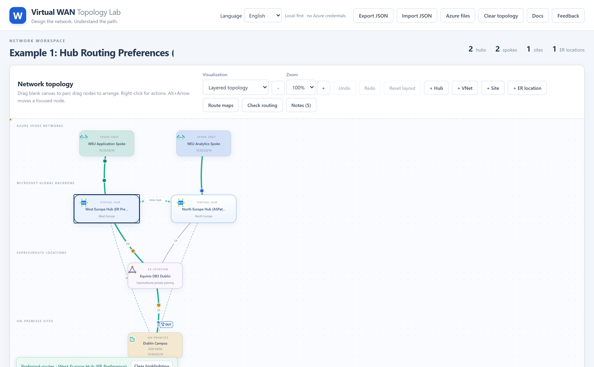
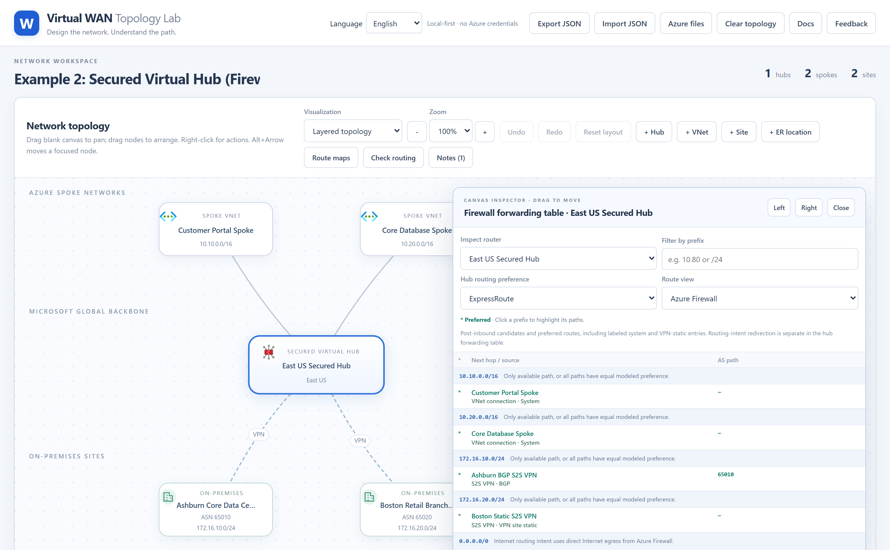
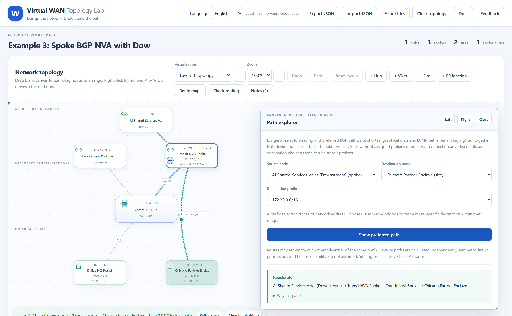
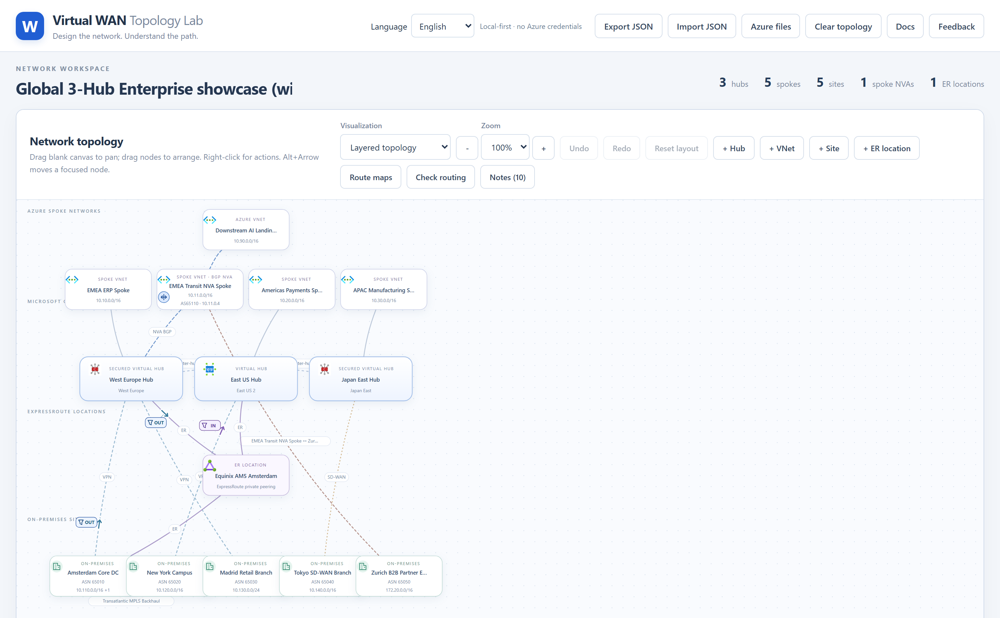
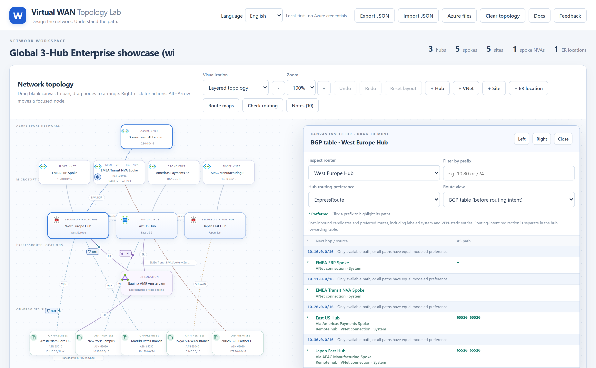
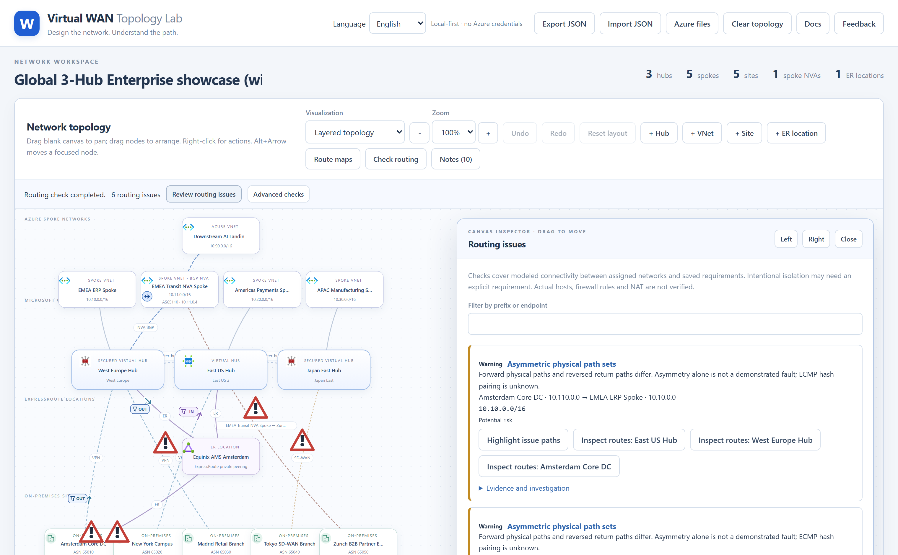
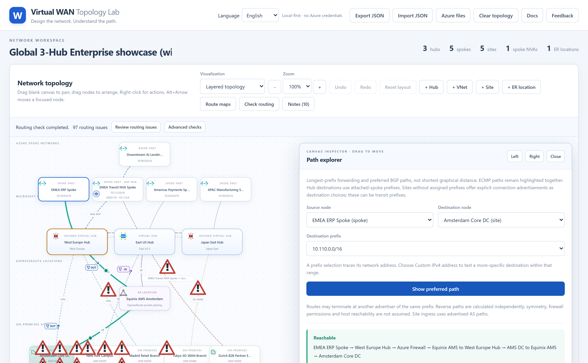
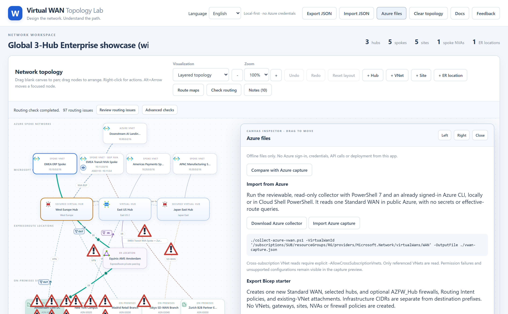

# Azure Network Simulator (AzNetSim): User Guide & Worked Examples

**Language / 言語:** **English** | [日本語](./README.ja.md)  
**Live Application:** [https://aznet-simulator.com](https://aznet-simulator.com)

**Interactive Web Documentation:** [https://aznet-simulator.com/docs/](https://aznet-simulator.com/docs/) ([日本語版](https://aznet-simulator.com/docs/?lang=ja))

**Azure Network Simulator (AzNetSim)** is a local-first topology designer and explainable planning simulator for classic Azure VNets, hub-and-spoke, Virtual WAN, and hybrid/on-premises networks. Browser and Windows desktop clients share the simulation platform; no Azure credentials are needed for simulation. Explore effective routes, BGP/UDRs, Route Server, Firewall/NVA paths, and supported packet-flow declarations. It is not a live Azure control plane or a guarantee of packet delivery.

The worked examples below focus on **Virtual WAN**, one part of AzNetSim. For classic VNet and mixed-network examples, see the [sample catalog](./sample-catalog.md), [Azure VNet samples](../samples/README.md#comprehensive-azure-vnet-topologies-samplesazure-net), and the [current feature scope and limitations](../README.md#scope). `vwan-simulator.com` and legacy files/links remain supported; browser saves remain separate per website origin.

---

## Table of Contents

1. [Step-by-Step Instructions](#1-step-by-step-instructions)
2. [Downloadable Sample JSON Topologies](#2-downloadable-sample-json-topologies)
3. [Example 1: Hub Routing Preferences (`ExpressRoute` vs `VPN` vs `ASPath`)](#3-example-1-hub-routing-preferences-expressroute-vs-vpn-vs-aspath)
4. [Example 2: Secured Virtual Hub & Azure Firewall Routing Intent](#4-example-2-secured-virtual-hub--azure-firewall-routing-intent)
5. [Example 3: Spoke BGP NVA Transit to Downstream VNet & Partner Site](#5-example-3-spoke-bgp-nva-transit-to-downstream-vnet--partner-site)
6. [Example 4: 3-Hub All-Features Enterprise Showcase (with Asymmetric Routing)](#6-example-4-3-hub-all-features-enterprise-showcase-with-asymmetric-routing)
7. [Inspecting Effective Routes, Path Explorer & Automated Diagnostics](#7-inspecting-effective-routes-path-explorer--automated-diagnostics)
8. [Azure Bicep Export & Observed Snapshot Comparison](#8-azure-bicep-export--observed-snapshot-comparison)
9. [Current Workspace and Modeling Workflows](#9-current-workspace-and-modeling-workflows)
10. [Local MCP Setup](#10-local-mcp-setup)

---

## 1. Step-by-Step Instructions

The compact interface is the default, with one primary row: **Tools**, **Learn**,
**Explore**, **Checks**, **File**, **Azure**, **Settings** and **Help**. Account
and belt controls have separate targets. **Settings** holds theme, language,
canvas styles and **Use legacy UI**. **Help** opens **Docs** and **Feedback**;
desktop Docs opens the bundled offline guide and feedback stays disabled.
**Checks** groups **Check routing** and **Advanced checks**. Zoom, view and
layout controls stay beside the canvas; tabs and save status remain distinct.

On compact windows, **Workspace actions** shows or hides the tools row.
Secondary commands adapt to the available width. Empty-canvas **Add a resource**,
**Open a design** and **Load an example** shortcuts can be dismissed and disappear
when resources are added. Selected-resource configuration, route inspection,
trace and connection shortcuts can be minimized without losing selection.
**All actions** opens the searchable Tools drawer; right-click remains available.

In the mixed-network inspector, on-premises advertised prefixes, site ASNs and
VNet address-space lists **save on blur** (click outside the field or press Tab).
Comma-separated prefix lists retain commas and spaces while you type; clearing a
site's list withdraws its advertised prefixes. Names still update immediately.
Legacy Virtual WAN configuration dialogs use **Save changes** instead.

On the web, **Help > Windows app** opens the [Microsoft Store listing](https://apps.microsoft.com/detail/9P76BP1MXWZ2), and
**Help > MCP server** opens local MCP setup. These links are in Help, not on the
empty canvas, and leave the current design unchanged.

1. **Open a workspace**: New sessions start with an empty mixed-network design; **Workspace** opens saved designs or creates a new one. There is no architecture-mode selector. Classic VNets and Virtual WAN hubs can coexist. Legacy Virtual WAN files and samples open in their compatible native editor without lossy conversion.
2. **Add Topology Objects**: Use the contextual workspace controls or right-click blank canvas to add Virtual WAN hubs, spoke/hub VNets, on-premises branch/datacenter sites, and ExpressRoute peering locations.
3. **Add Optional Custom Node Labels**: Every node (Hub, Spoke/VNet, ExpressRoute Location, and On-Premises Site) supports an optional `label` text annotation (up to 120 characters) rendered as an amber pill badge directly on the diagram:
   - Open the selected object's configuration dialog or inspector to edit its label. Legacy Virtual WAN objects expose **Edit configuration** → **Optional diagram label**.
4. **Configure Connections & Routing Policies**: Right-click any node or link on the canvas to open its context menu:
   - **Virtual Hubs**: Configure the hub routing preference (`ExpressRoute`, `VPN`, or `ASPath`), enable **Secured Virtual Hub** Azure Firewall Routing Intent (Private traffic and/or Internet traffic), inspect the **BGP table** / **Learned routes** / **Advertised routes** / **Firewall routes**, or click **Highlight preferred routes**.
   - **Spoke VNets**: Attach a **BGP NVA**, connect downstream standalone Azure VNets or downstream on-premises sites behind that NVA, or configure spoke connection route maps.
   - **On-Premises Sites**: Connect to hubs via **ExpressRoute**, **VPN** (BGP or Static), or **SD-WAN**; add site-to-site WAN links; or configure site route maps and static routing tables.
5. **Save, Share, or Load JSON Topologies**: Use **Load**, **Save** and **Save As** for explicit artifact operations; recovery storage is not a JSON backup. See the [document lifecycle](./document-lifecycle.md) for destination and close behavior. Web users can explicitly save a cloud copy and enable a revocable read-only link through [Cloud account](./cloud-accounts.md#read-only-sharing). Old `#s=...` links remain read-only embedded snapshots; new full-topology links are no longer generated. Desktop users can share local JSON files.

---

## 2. Downloadable Sample JSON Topologies

Screenshots illustrate the sample scenarios and may show older controls; they are
not verified captures of the current compact UI. Download a `.json` file and open
it through **Load**, or choose **Open in Simulator** at `aznet-simulator.com`.
Save current work before replacing it:

| Example | Scenario | Sample JSON File | One-Click Launch |
| :--- | :--- | :--- | :--- |
| **Example 1** | Hub Routing Preferences (`ExpressRoute` vs `ASPath`) | [`hub-routing-preferences.json`](../samples/hub-routing-preferences.json) | [Open in Simulator](https://aznet-simulator.com/?sample=hub-routing-preferences) |
| **Example 2** | Secured Virtual Hub & Firewall Routing Intent | [`secured-hub-routing-intent.json`](../samples/secured-hub-routing-intent.json) | [Open in Simulator](https://aznet-simulator.com/?sample=secured-hub-routing-intent) |
| **Example 3** | Spoke BGP NVA Transit (Downstream VNet + Partner Site) | [`spoke-bgp-nva-transit.json`](../samples/spoke-bgp-nva-transit.json) | [Open in Simulator](https://aznet-simulator.com/?sample=spoke-bgp-nva-transit) |
| **Example 4** | 3-Hub All-Features Showcase (with Asymmetric Routing) | [`three-hub-all-features-asymmetric.json`](../samples/three-hub-all-features-asymmetric.json) | [Open in Simulator](https://aznet-simulator.com/?sample=three-hub-all-features-asymmetric) |

---

## 3. Example 1: Hub Routing Preferences (`ExpressRoute` vs `VPN` vs `ASPath`)

- **Sample JSON:** [`samples/hub-routing-preferences.json`](../samples/hub-routing-preferences.json)
- **Live Link:** [https://aznet-simulator.com/?sample=hub-routing-preferences](https://aznet-simulator.com/?sample=hub-routing-preferences)

In this scenario, **Dublin Campus** (`10.50.0.0/16`, ASN `65050`) advertises the same prefix to two Virtual WAN hubs over both **ExpressRoute** (with an outbound route map prepending `65050 65050` so the ExpressRoute AS path is 3 hops long) and **BGP S2S VPN** (1 hop):

- **West Europe Hub (ER Preference)** selects the **ExpressRoute** path to `10.50.0.0/16` despite its 3-hop AS path because its hub routing preference is `ExpressRoute`.
- **North Europe Hub (ASPath Preference)** selects the 1-hop **BGP S2S VPN** path because its hub routing preference is `ASPath`.



---

## 4. Example 2: Secured Virtual Hub & Azure Firewall Routing Intent

- **Sample JSON:** [`samples/secured-hub-routing-intent.json`](../samples/secured-hub-routing-intent.json)
- **Live Link:** [https://aznet-simulator.com/?sample=secured-hub-routing-intent](https://aznet-simulator.com/?sample=secured-hub-routing-intent)

This scenario models **East US Secured Hub** with Azure Firewall Routing Intent enabled for both **Private traffic** (`10.0.0.0/8`, `172.16.0.0/12`) and **Internet traffic** (`0.0.0.0/0`):

- Spoke-to-spoke, spoke-to-branch, and internet-bound traffic is steered through **Azure Firewall**.
- **Boston Retail Branch** connects via **Static S2S VPN** with `Propagate Default Route` enabled so it learns `0.0.0.0/0` from the Secured Hub.



---

## 5. Example 3: Spoke BGP NVA Transit to Downstream VNet & Partner Site

- **Sample JSON:** [`samples/spoke-bgp-nva-transit.json`](../samples/spoke-bgp-nva-transit.json)
- **Live Link:** [https://aznet-simulator.com/?sample=spoke-bgp-nva-transit](https://aznet-simulator.com/?sample=spoke-bgp-nva-transit)

**Central US Hub** peers over BGP with a Network Virtual Appliance (`10.10.0.4`, ASN `65100`) inside **Transit NVA Spoke** (`10.10.0.0/16`). The NVA provides transit to both:
- **AI Shared Services VNet (Downstream)** (`10.99.0.0/16`) — a standalone Azure VNet peered to the NVA spoke rather than directly to Virtual WAN.
- **Chicago Partner Enclave** (`172.30.0.0/16`, ASN `65050`) — a downstream on-premises partner site terminating on the NVA.



---

## 6. Example 4: 3-Hub All-Features Enterprise Showcase (with Asymmetric Routing)

- **Sample JSON:** [`samples/three-hub-all-features-asymmetric.json`](../samples/three-hub-all-features-asymmetric.json)
- **Live Link:** [https://aznet-simulator.com/?sample=three-hub-all-features-asymmetric](https://aznet-simulator.com/?sample=three-hub-all-features-asymmetric)

This 3-hub enterprise topology combines **West Europe Hub** (Secured, `ExpressRoute` preference), **East US Hub** (`VPN` preference), and **Japan East Hub** (Secured, `ASPath` preference) with ExpressRoute, BGP VPN, Static VPN, SD-WAN, a Spoke BGP NVA, on-premises site-to-site WAN links, and inbound/outbound Route Maps.

It also includes an intentional **asymmetric routing** condition between Azure spokes and **Amsterdam Core DC** (`10.100.0.0/16`):
- **Forward path (`EMEA ERP Spoke` → `Amsterdam Core DC`)**: Uses **ExpressRoute** (`Equinix AM5 Amsterdam`) because `West Europe Hub` prefers `ExpressRoute`.
- **Return path (`Amsterdam Core DC` → `EMEA ERP Spoke`)**: Uses **BGP VPN** because `West Europe Hub` applies outbound route map `WEU-ER-Out-Prepend` (`64496 64496`) on its ExpressRoute link, making ExpressRoute a 3-hop AS path (`65515 64496 64496`) while the BGP VPN backup link remains a 1-hop AS path (`65515`).



---

## 7. Inspecting Effective Routes, Path Explorer & Automated Diagnostics

### Effective Routes & BGP Table Inspector
Right-click any hub, site, or ExpressRoute location and select **BGP table**, **Learned routes**, or **Advertised routes** to inspect all candidate routes, AS paths, and selection tie-breakers:



### Automated Routing Check (Asymmetric Path Detection)
Use **Checks > Check routing**, then **Review routing issues** to inspect modeled
asymmetry between Azure spokes and **Amsterdam Core DC**. Review scope and
completion: interrupted and unassessed runs do not establish a clean result.



### Acknowledging reviewed warnings
Use **Acknowledge warning** on an eligible warning to remove its attention decoration
without changing severity, routing, grading or diagnostic evidence. The readable
**Acknowledged warnings** group follows all active findings; trace and inspection
actions remain available. **Restore attention** reverses an individual decision;
**Restore all warning attention** also clears saved decisions for warnings no longer
in the current results. Errors, connectivity failures, informational findings and
unassessed/model-limit results cannot be acknowledged.

Acknowledgements are optional `warningAcknowledgements` metadata in the design:
they follow local autosave, JSON export/import, cloud saves and undo/redo, not the
global analysis profile or account. New designs do not inherit them. Unchanged
analysis preserves them; changed structural evidence or relevant resource/route
configuration requires attention again. Fingerprints exclude display names,
translation and layout, and normalize unordered finding groups. Changes elsewhere
on an involved resource can conservatively require review again. Up to 4096
decisions are retained; restore existing decisions to free space. Existing files
without the field remain supported. Informational peering-bypass messages keep
their existing severity and are not promoted to warnings by this feature.

### Interactive Path Explorer
Right-click any node and select **Open path explorer** to trace specific source-to-destination flows and expand **"Why this path?"** for hop-by-hop explanations:



---

## 8. Azure Bicep Export & Observed Snapshot Comparison

Open **Azure**, then the applicable **Azure files** or **Azure & Bicep** panel to:
- **Download a scoped Azure Bicep starter (`.bicep`)**. Review prerequisites, supported resources and omissions before deployment; it is not a complete production design. The VWAN attachment starter does not modify existing VNets.
- **Download the read-only PowerShell Azure CLI collector script ([`scripts/collect-azure-vwan.ps1`](https://github.com/erjosito/vwan-visual-topology-feedback/blob/main/scripts/collect-azure-vwan.ps1))** to collect a live Virtual WAN topology and effective route tables from Azure:
  ```powershell
  Invoke-WebRequest -Uri 'https://raw.githubusercontent.com/erjosito/vwan-visual-topology-feedback/main/scripts/collect-azure-vwan.ps1' -OutFile ./collect-azure-vwan.ps1
  ./collect-azure-vwan.ps1 -VirtualWanId '/subscriptions/SUB/resourceGroups/RG/providers/Microsoft.Network/virtualWans/WAN' -IncludeEffectiveRoutes -OutputFile ./vwan-observation.json
  ```
- **Import and compare recorded Azure routes/fields** against modeled evidence. Missing, denied, stale and unsupported observations remain explicit, not continuous live monitoring.

Windows can deliberately use its local read-only Azure CLI broker when required
tools are already installed. No subscription credentials go to the canvas
renderer. **Report a discrepancy** exports a reviewed local issue ZIP with
topology/evidence and reproduction context, not an automatic upload. Addresses,
resource IDs, notes and original collector metadata are not anonymized.
See [Azure files and discrepancy replay](./azure-files.md).



## 9. Current Workspace and Modeling Workflows

The [bilingual documentation site](https://aznet-simulator.com/docs/) also ships
with Electron. These stable sections contain the same user-facing workflows:

| Subject | Guide |
| --- | --- |
| Save, Save As, tab ownership and unavailable profile recovery | [Save and recovery](https://aznet-simulator.com/docs/#save-recovery) |
| Private library, GUID-preserving batch backups and revocable web links | [Cloud backup and sharing](https://aznet-simulator.com/docs/#cloud-backup-sharing) |
| Draft-preserving optional VWAN sections and mixed inspector commits | [Configuration](https://aznet-simulator.com/docs/#optional-editors) |
| Gateway transit, dual ExpressRoute, isolated overlap and VPN NAT | [Hybrid routing](https://aznet-simulator.com/docs/#routing-configuration) |
| Routes, BGP neighbors, scoped checks, warning attention and flow exports | [Inspection and checks](https://aznet-simulator.com/docs/#diagnostics-and-trace) |
| NSGs, NAT, Standard LB, approved Private Link and private proxies | [Packet/application scope](https://aznet-simulator.com/docs/#packet-application-scope) |
| Isolated practice, revised editions, evidence and curriculum credit | [Learning](https://aznet-simulator.com/docs/#learning) |

**Save is not recovery:** first Save asks for a destination; repeated Save uses
the last confirmed one, and Save As changes it only after success. Open save
status to distinguish local profile recovery, a confirmed file and matching
cloud content. Unconfirmed downloads and edits made during an earlier upload
are not confirmed saves. If recovery is unavailable or owned by another window,
use **Save a file** or configured **Save to cloud** and save each changed tab
before closing. Apply configuration drafts first; close supports Save/Discard/Cancel.

**Cloud is explicit:** personal-account cloud saves need configured support.
Topology edits do not automatically upload. Library backups retain original
cloud-save GUIDs and native resource IDs. Import previews skip identical content,
keep conflicts by default and require individual reviewed overwrite choices.
Batch import is not transactional. Backups exclude sharing permissions, learning
history and local file capabilities, but do not redact secrets embedded in JSON.
Web shared links expose the latest saved version for 30 days, not unsaved edits
or a pinned snapshot; owner revocation cannot recall downloaded copies. Electron
shares local JSON, not cloud links. See [cloud account details](./cloud-accounts.md).

**Configuration is preserved when hidden:** optional VWAN sections retain mounted
inputs and drafts, summarize configured values and do not hide surrounding
warnings. Isolated overlapping VNets do not imply connectivity; direct overlapping
peerings are rejected and shared-transit ambiguity can remain unassessed. A local
gateway conflicts with remote gateway transit even when disabled. Azure-local
ExpressRoute weight does not select the reverse site path.

**Packet/application models are bounded:** original NIC/subnet policies and return
paths are separate from effective routes. Native v2 composed private SNAT supports
up to four declared NVA interfaces, with later rules matching translated tuples
and inverse mappings only after independently reaching each translator. Approved
Private Link Service connections bind a consumer endpoint to one provider NAT
configuration and a Standard internal NIC-backed LB, not general VNet transit.
Private Application Gateway TCP and Standard/Premium Firewall explicit or
intercepted application proxies model separate client/upstream connections using
original declarations. HTTP Host and non-inspected HTTPS SNI have different
destination semantics. These contracts do not promise UI editors for every field.
Generic HTTP delivery, Front Door, live DNS, TLS inspection, arbitrary extra-router
composition, capacity and application availability remain unavailable/unassessed.
Use the [current application contract](../src/application-capabilities.ts) and
installed MCP discovery rather than inferring guarantees from service names.

## 10. Local MCP Setup

Follow the [bilingual MCP setup section](https://aznet-simulator.com/docs/#mcp-server)
(also bundled offline) for Node 22+, portable `mcp-v<version>` releases, source
builds, stdio client configuration and updates. Read `get_capabilities` and
`get_schema` for installed operations/native examples, validate admission first,
then evaluate explicit supported assertions and read bounded evidence.
The server does not deploy Azure or edit the app canvas. Your AI client can send
inputs/results to its provider; local MCP does not make hosted Copilot offline.
The [platform MCP contract](../PLATFORM.md#local-mcp--copilot-skill) is a secondary
technical reference, not a replacement for user setup instructions.
