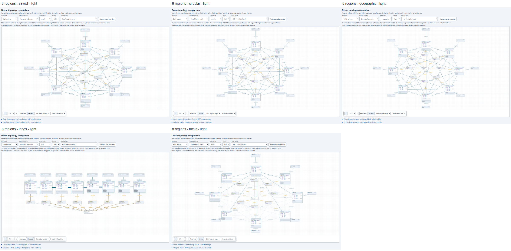
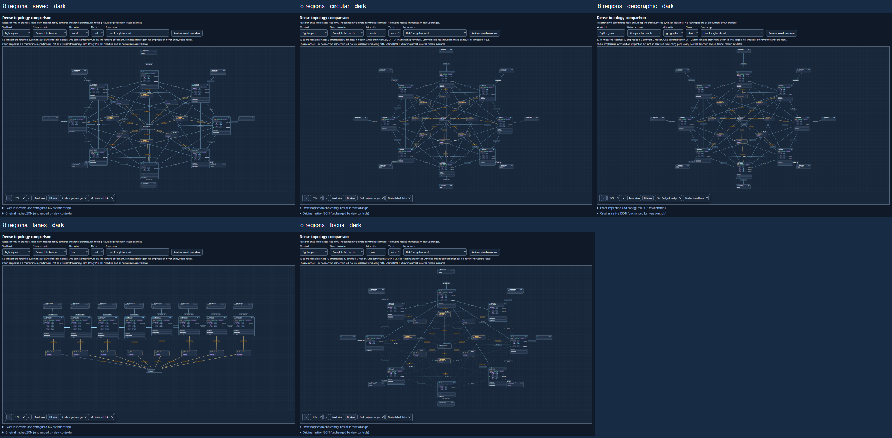

# Dense-topology visualization comparison

## Decision

Do **not** replace saved coordinates with a circular or lane layout on this
evidence. The next production candidate should be reversible, selection-based
connection emphasis, preserving coordinates, with explicit counts, keyboard
inspection and a one-action restore. It is a candidate for human comparison,
not a demonstrated usability improvement. The research prototype is deliberately
excluded from the production build.

The comparison exposes why a layout-only change is insufficient: circles reduce
some label collisions but shrink already-small text; lanes concentrate mesh
connections into overlapping horizontal strokes. Focus preserves the mental map,
but retaining readable labels means label congestion is not solved. A later
regional-overview/semantic-zoom experiment may help; it has not been validated
here and must not silently hide devices, policies or failures.

## Fixture, privacy and model boundary

`tests\fixtures\dense-visualization.ts` is independently authored from the public
issue's workload counts. No private source file, original identifier or original
screenshot was loaded, copied, uploaded or committed.

The dense fixture has eight hub VNets, eight spokes, 32 subnets, 16 routing NVAs,
eight ARS instances with 16 configured peer IDs each, 36 peerings, eight ER
locations, 16 ER links, one site, 25 ARS route maps, 98 rules and 40 rendered
IN/OUT markers. The 128 configured BGP relationships are **not** 128 drawn edges.
The canvas has 52 connection edges. One site ER attachment is administratively
OFF to test status preservation; this is not an observed Azure outage.

A two-region subset is the small control. Its saved and circular coordinates
intentionally retain the same fixed-radius placement strategy; therefore it
also tests that strategy's wasted-space behavior, not an optimized small layout.
A separate missing-peering scenario removes the hub-1/last-hub peering from a
fresh synthetic document. That explicit fixture change is not a view filter.

Both native v2 fixtures were validated through the installed local simulator MCP
using contract 1, engine `2026.11.18.2`: complete validation, no errors. Validation
is not forwarding qualification. No flow/route requirements were graded: visual
legibility, interaction cost and human discovery are not supported routing
assertions. The chain emphasis is explicitly a connection-inspection aid, **not
an assessed end-to-end forwarding path**. Remote ARS support, convergence,
security and live traffic remain unassessed.

## Reproduce and inspect

```powershell
npm run dev -- --host 127.0.0.1 --port 4173 --strictPort
# Open http://127.0.0.1:4173/verification/dense-topology-comparison.html
```

In another terminal:

```powershell
$env:PLAYWRIGHT_JSON_OUTPUT_NAME='test-artifacts\visualization-240-report.json'
npx playwright test dense-visualization.spec.ts --output=test-artifacts\visualization-240 --reporter=list,json --workers=2
```

The dev-only page uses the actual `AzureNetDiagram`, native policy markers,
connection selection, keyboard activation, zoom and theme colors. It does not
run a substitute renderer or invent routing output. Coordinate editing is
disabled; alternative coordinates apply only to a cloned presentation document.
Every alternative retains the original graph and exact original JSON. The
restore action returns to the saved-coordinate view.

The test runner attaches full-size screenshots, contact sheets, geometry
observations and raw baseline/focused axe reports. The committed contact sheets
below show the five alternatives side by side at reduced size; use the full-size
attachments or interactive page to inspect labels.





## Measured geometry

All cells use the same 1600 x 1100 viewport, 850 px canvas region, native
mode-default curves and Fit view. Light and dark geometry agreed. Raw observations
are preserved in `issue-240-observations.json`.

| Dense alternative | Fit zoom | Text-box overlap pairs | Approximate crossing edge pairs | Median SVG text-box height | De-emphasized strokes |
| --- | ---: | ---: | ---: | ---: | ---: |
| Authored saved coordinates | 31% | 28 | 85 | 4 px | 0 / 52 |
| Numeric circular rings | 27% | 8 | 85 | 4 px | 0 / 52 |
| Geographic-order rings | 27% | 7 | 83 | 4 px | 0 / 52 |
| Regional lanes | 37% | 48 | 4 | 5 px | 0 / 52 |
| Saved coordinates + hub focus | 31% | 28 | 85 | 4 px | 42 / 52 |

No policy-marker boxes overlap in these specimens. That does not establish that
markers are legible at 4 px median text height, nor count marker/edge occlusion.
The geographic ordering is a declared west-to-east regional sequence, not a map
projection or a geographic-distance optimization.

Text overlap counts pairwise screen-space SVG text bounding rectangles, not
semantic readability. Crossing counts sample each native curve into 24 segments
and count intersecting edge pairs outside node boxes, once per pair. Shared
endpoints, tangencies and **collinear overlap are not crossings**. In particular,
the lane score of 4 must not be interpreted as clean mesh routing: many peerings
lie on top of one another, as the screenshots show.

For the two-region control, lanes have 0 text-overlap pairs and 9 px median text
height; saved/focus have 1 pair and 4 px, and the two circular orders have 0 pairs
and 4 px. All have 0 measured crossing pairs and 0 marker overlaps. This small
control favors compact lanes, but does not generalize to eight-region meshes.

Each raw observation also records one scripted alternative-switch + Fit view +
two-animation-frame elapsed sample. These include browser automation overhead,
dev-server work and concurrent validation load; they are not production
render-time benchmarks, percentile measurements or participant task times.

## Alternatives and tradeoffs

| Approach | Observed result or prediction | Recommendation |
| --- | --- | --- |
| Numeric/geographic circles | Measured fewer text-box collisions, but lower fit zoom; geographic reordering barely changes crossings | Do not make a new global default or overwrite manual coordinates |
| Regional lanes | Measured better small-control fit; dense links overlap and labels collide despite a low crossing count | Consider as an explicit small-topology option only after task testing |
| Focus/dimming | Retains all 52 edges and 40 markers; 10 strokes remain emphasized for hub 1, including the OFF link; label geometry is unchanged | First reversible production candidate, with counts and restore; no blanket fading of accessible text |
| Collapsible clusters/semantic zoom | Not implemented or measured; plausibly improves overview text size, but can conceal policies/devices and destabilize expansion | Separate experiment with explicit hidden-state summaries and stable expansion |
| Bundled mesh edges | Not implemented or measured; could remove repeated strokes but imply shared forwarding or obscure policy direction | Defer until individual expansion, direction and failure semantics are specified |
| Adjacency/control-plane view | Inspection list helps distinguish configured peers from drawn transport; a full matrix is not implemented | Complement a canvas, not a replacement for path inspection |

The focus prototype dims strokes only, leaving labels, directional IN/OUT
markers, devices and OFF text intact. A dimmed connection returns to full
emphasis on hover or keyboard focus. Chain emphasis additionally uses a thicker
dashed stroke, not color alone. No connections are hidden by focus.

## Tasks, correctness and human evidence

Five tests cover native admission/graph preservation and the two sizes in both
themes. Each browser case exercises all five alternatives. The scripted checks
are:

| Task | Scripted evidence and limitation |
| --- | --- |
| Locate local and remote ARS peers | Original IDs remain in the expandable inspection list; no inference that remote configured BGP equals supported forwarding |
| Distinguish an absent peering | Missing fixture exposes 6/7 remote-hub peerings, or 0/1 in the small control, with the absent original ID not rendered in saved and focus views |
| Follow the selected connection chain | Three peering edges receive dashed emphasis, plus the local ER attachment and persistent OFF link; this is not a routing-path grade |
| Find a route-map attachment | Keyboard activates the native inbound marker and returns original ARS owner, connection and direction |
| Identify failed/disabled transport | The administratively OFF ER link remains unmuted, with native dashed stroke and OFF text; live/simulated failures are not assessed by this fixture |

Selecting a variant and fitting it takes two explicit control actions; restoring
the saved overview takes one. Connection and policy activation are exercised
with focus + Enter. These are scripted interaction counts, not measured human
completion, time, mistakes or perceived complexity.

**Human participants: zero.** Completion rates, discovery times, mistakes and
perceived complexity remain unmeasured. Use the same five tasks in counterbalanced
saved/alternative order with first-time and experienced engineers before
production selection. Record raw outcomes and hints, including whether readers
mistake configured BGP, a highlighted connection chain or OFF status for routing
evidence. Include narrow/touch, EN/JA and screen-reader trials in that next phase;
this research page is English-only and not a production localization surface.

The whole-page axe comparison found existing `label-content-name-mismatch`
findings on 86 dense and 17 small-control native diagram elements in both themes.
Focus introduces no additional rule/target findings, but this is **not a clean
accessibility audit or WCAG conformance claim**. Correct those inherited names
before promoting a new production visualization. Do not waive them by disabling
the rule or excluding diagram controls.

Those counts describe the original research capture on source base `c652c18`.
The subsequent #228 follow-up reuses the native accessible-label helper for
these controls and strengthens the browser regression to require zero baseline
violations. The committed geometry observations and contact sheets above remain
the original comparison, rather than relabeling historical evidence as a new run.

Build, research-entry type checking, five browser tests and lint pass (one
existing `ErLocationInfoModal` warning). No simulation code, saved schema,
production layout, desktop integration or application entry point changes.
The comparative research is ready for review; human validation and any
production visualization choice remain explicitly pending.
