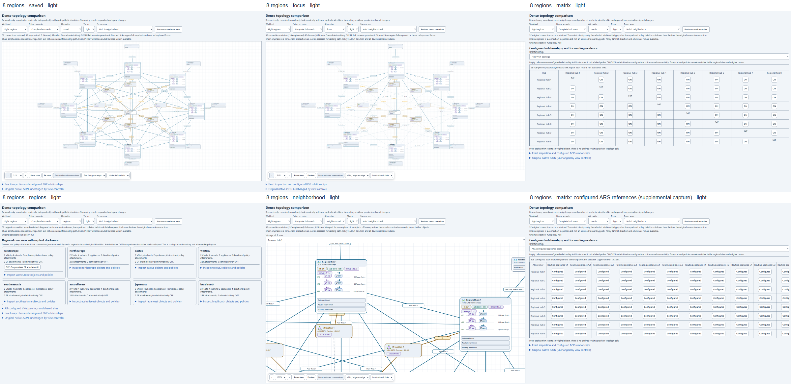
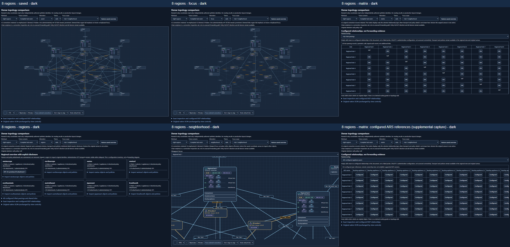

# Dense-topology visualization comparison

## Decision

Do **not** replace saved coordinates with a circular or lane layout on this
evidence. The next production candidate should be reversible, selection-based
connection emphasis, preserving coordinates, with explicit counts, keyboard
inspection and a one-action restore. It is a candidate for human comparison,
not a demonstrated usability improvement. The research prototype is deliberately
excluded from the production build.

The comparison exposes why a layout-only change is insufficient: circles reduce
some label collisions but shrink already-small text; lanes concentrate mesh
connections into overlapping horizontal strokes. Focus preserves the mental map,
but retaining readable labels means label congestion is not solved. A later
regional-overview/semantic-zoom experiment may help; it has not been validated
here and must not silently hide devices, policies or failures.

### Approved production follow-up

After reviewing the recommendation, the maintainer approved a bounded
production connection-focus command. The hub-spoke/full canvas now offers
**Focus selected connections** and **Restore all connections**. A node focuses
its direct rendered attachments; a device/subnet uses its parent VNet; a
connection focuses that individual connection. Focus stays on that original
scope while other objects are inspected, until explicitly refocused or restored.
It is local view state, not a saved topology edit or a routing/path assertion.

Only unrelated connection strokes become translucent. All labels, nodes,
policy markers and interaction targets remain mounted and undimmed. OFF/access-
disabled connections, simulated failures, visible connection-specific findings
and existing forward/return highlights remain prominent. Hover or keyboard
focus temporarily emphasizes a dimmed connection. The status identifies the
scope and counts rendered connections, emphasized/dimmed strokes and zero hidden
connections; logical BGP relationships are not included in that count. The
global clear-highlights command also clears connection focus.

The explicit Restore action preserves selection, faults, routing highlights,
manual coordinates, zoom and pan. Deleted targets fall back to an emphasized
overview with an honest status rather than silently choosing a replacement.
Native VWAN mode is outside this native-topology slice; automatic layouts,
clustering, filtering, aggregation and production path-chain selection are not
introduced. The existing synthetic comparison and its historical measurements
remain separate from the production feature. Human participants remain zero,
and label congestion remains unresolved.

Seven new browser cases explicitly use the new UI and cover small hub-spoke/full
documents in EN/light and JA/dark (including 390 px), plus the eight-region
workload in both themes with Fit view.
They check counts, exact saved JSON/coordinates, connection and directional
policy inspection, keyboard emphasis, failure visibility, restore and scoped
axe checks. An existing engine path is also kept prominent, with its inspected
forward/reverse pair unchanged while the Path explorer remains open.
Screenshots are saved in their Playwright output directories.
Reproduce the production cases with:

```powershell
npx playwright test canvas-presentation.spec.ts dense-visualization.spec.ts -g "connection focus" --workers=1
```

## Fixture, privacy and model boundary

`tests\fixtures\dense-visualization.ts` is independently authored from the public
issue's workload counts. No private source file, original identifier or original
screenshot was loaded, copied, uploaded or committed.

The dense fixture has eight hub VNets, eight spokes, 32 subnets, 16 routing NVAs,
eight ARS instances with 16 configured peer IDs each, 36 peerings, eight ER
locations, 16 ER links, one site, 25 ARS route maps, 98 rules and 40 rendered
IN/OUT markers. The 128 configured BGP relationships are **not** 128 drawn edges.
The canvas has 52 connection edges. One site ER attachment is administratively
OFF to test status preservation; this is not an observed Azure outage.

A two-region subset is the small control. Its saved and circular coordinates
intentionally retain the same fixed-radius placement strategy; therefore it
also tests that strategy's wasted-space behavior, not an optimized small layout.
A separate missing-peering scenario removes the hub-1/last-hub peering from a
fresh synthetic document. That explicit fixture change is not a view filter.

Both native v2 fixtures were validated through the installed local simulator MCP
using contract 1, engine `2026.11.18.2`: complete validation, no errors. Validation
is not forwarding qualification. No flow/route requirements were graded: visual
legibility, interaction cost and human discovery are not supported routing
assertions. The chain emphasis is explicitly a connection-inspection aid, **not
an assessed end-to-end forwarding path**. Remote ARS support, convergence,
security and live traffic remain unassessed.

## Reproduce and inspect

```powershell
npm run dev -- --host 127.0.0.1 --port 4173 --strictPort
# Open http://127.0.0.1:4173/verification/dense-topology-comparison.html
```

In another terminal:

```powershell
$env:PLAYWRIGHT_JSON_OUTPUT_NAME='test-artifacts\visualization-240-report.json'
npx playwright test dense-visualization.spec.ts --output=test-artifacts\visualization-240 --reporter=list,json --workers=2
```

The dev-only page uses the actual `AzureNetDiagram`, native policy markers,
connection selection, keyboard activation, zoom and theme colors. It does not
run a substitute renderer or invent routing output. Coordinate editing is
disabled; alternative coordinates apply only to a cloned presentation document.
Every alternative retains the original graph and exact original JSON. The
restore action returns to the saved-coordinate view.

The test runner attaches full-size screenshots, contact sheets, geometry
observations and raw baseline/focused axe reports. The committed contact sheets
below show the five alternatives side by side at reduced size; use the full-size
attachments or interactive page to inspect labels.


## Measured geometry

All cells use the same 1600 x 1100 viewport, 850 px canvas region, native
mode-default curves and Fit view. Light and dark geometry agreed. Raw observations
are preserved in `issue-240-observations.json`.

| Dense alternative | Fit zoom | Text-box overlap pairs | Approximate crossing edge pairs | Median SVG text-box height | De-emphasized strokes |
| --- | ---: | ---: | ---: | ---: | ---: |
| Authored saved coordinates | 31% | 28 | 85 | 4 px | 0 / 52 |
| Numeric circular rings | 27% | 8 | 85 | 4 px | 0 / 52 |
| Geographic-order rings | 27% | 7 | 83 | 4 px | 0 / 52 |
| Regional lanes | 37% | 48 | 4 | 5 px | 0 / 52 |
| Saved coordinates + hub focus | 31% | 28 | 85 | 4 px | 42 / 52 |

No policy-marker boxes overlap in these specimens. That does not establish that
markers are legible at 4 px median text height, nor count marker/edge occlusion.
The geographic ordering is a declared west-to-east regional sequence, not a map
projection or a geographic-distance optimization.

Text overlap counts pairwise screen-space SVG text bounding rectangles, not
semantic readability. Crossing counts sample each native curve into 24 segments
and count intersecting edge pairs outside node boxes, once per pair. Shared
endpoints, tangencies and **collinear overlap are not crossings**. In particular,
the lane score of 4 must not be interpreted as clean mesh routing: many peerings
lie on top of one another, as the screenshots show.

For the two-region control, lanes have 0 text-overlap pairs and 9 px median text
height; saved/focus have 1 pair and 4 px, and the two circular orders have 0 pairs
and 4 px. All have 0 measured crossing pairs and 0 marker overlaps. This small
control favors compact lanes, but does not generalize to eight-region meshes.

Each raw observation also records one scripted alternative-switch + Fit view +
two-animation-frame elapsed sample. These include browser automation overhead,
dev-server work and concurrent validation load; they are not production
render-time benchmarks, percentile measurements or participant task times.

## Alternatives and tradeoffs

| Approach | Observed result or prediction | Recommendation |
| --- | --- | --- |
| Numeric/geographic circles | Measured fewer text-box collisions, but lower fit zoom; geographic reordering barely changes crossings | Do not make a new global default or overwrite manual coordinates |
| Regional lanes | Measured better small-control fit; dense links overlap and labels collide despite a low crossing count | Consider as an explicit small-topology option only after task testing |
| Focus/dimming | Retains all 52 edges and 40 markers; 10 strokes remain emphasized for hub 1, including the OFF link; label geometry is unchanged | First reversible production candidate, with counts and restore; no blanket fading of accessible text |
| Collapsible clusters/semantic zoom | Not implemented or measured; plausibly improves overview text size, but can conceal policies/devices and destabilize expansion | Separate experiment with explicit hidden-state summaries and stable expansion |
| Bundled mesh edges | Not implemented or measured; could remove repeated strokes but imply shared forwarding or obscure policy direction | Defer until individual expansion, direction and failure semantics are specified |
| Adjacency/control-plane view | Inspection list helps distinguish configured peers from drawn transport; a full matrix is not implemented | Complement a canvas, not a replacement for path inspection |

The focus prototype dims strokes only, leaving labels, directional IN/OUT
markers, devices and OFF text intact. A dimmed connection returns to full
emphasis on hover or keyboard focus. Chain emphasis additionally uses a thicker
dashed stroke, not color alone. No connections are hidden by focus.

## Tasks, correctness and human evidence

Five tests cover native admission/graph preservation and the two sizes in both
themes. Each browser case exercises all five alternatives. The scripted checks
are:

| Task | Scripted evidence and limitation |
| --- | --- |
| Locate local and remote ARS peers | Original IDs remain in the expandable inspection list; no inference that remote configured BGP equals supported forwarding |
| Distinguish an absent peering | Missing fixture exposes 6/7 remote-hub peerings, or 0/1 in the small control, with the absent original ID not rendered in saved and focus views |
| Follow the selected connection chain | Three peering edges receive dashed emphasis, plus the local ER attachment and persistent OFF link; this is not a routing-path grade |
| Find a route-map attachment | Keyboard activates the native inbound marker and returns original ARS owner, connection and direction |
| Identify failed/disabled transport | The administratively OFF ER link remains unmuted, with native dashed stroke and OFF text; live/simulated failures are not assessed by this fixture |

Selecting a variant and fitting it takes two explicit control actions; restoring
the saved overview takes one. Connection and policy activation are exercised
with focus + Enter. These are scripted interaction counts, not measured human
completion, time, mistakes or perceived complexity.

**Human participants: zero.** Completion rates, discovery times, mistakes and
perceived complexity remain unmeasured. Use the same five tasks in counterbalanced
saved/alternative order with first-time and experienced engineers before
production selection. Record raw outcomes and hints, including whether readers
mistake configured BGP, a highlighted connection chain or OFF status for routing
evidence. Include narrow/touch, EN/JA and screen-reader trials in that next phase;
this research page is English-only and not a production localization surface.

The whole-page axe comparison found existing `label-content-name-mismatch`
findings on 86 dense and 17 small-control native diagram elements in both themes.
Focus introduces no additional rule/target findings, but this is **not a clean
accessibility audit or WCAG conformance claim**. Correct those inherited names
before promoting a new production visualization. Do not waive them by disabling
the rule or excluding diagram controls.

Those counts describe the original research capture on source base `c652c18`.
The subsequent #228 follow-up reuses the native accessible-label helper for
these controls and strengthens the browser regression to require zero baseline
violations. The committed geometry observations and contact sheets above remain
the original comparison, rather than relabeling historical evidence as a new run.

Build, research-entry type checking, five browser tests and lint pass (one
existing `ErLocationInfoModal` warning). No simulation code, saved schema,
production layout, desktop integration or application entry point changes.
The comparative research is ready for review; human validation and any
production visualization choice remain explicitly pending.

## Semantic alternatives follow-up (2026-11-23)

### Critique before implementation

Repeating the ring/lane experiment would not resolve the previously observed
text and overlapping-stroke problems. Connection focus is already in production
and leaves label geometry unchanged. Instead, this follow-up tests genuinely
different representations against saved coordinates and existing focus:

| Candidate | Intended task | Why it is not an automatic replacement |
| --- | --- | --- |
| Configured relationship matrix | Find an absent hub peering or a local/remote configured ARS appliance reference | Loses geography, transport and policy context; repeated symmetric cells are not extra links, and configured references are not BGP-session or forwarding evidence |
| Collapsible regional inventory | Locate devices and directional policy attachments without a full mesh drawing | Readability comes from disclosure, not fitting all detail; counts and OFF state must remain explicit, and expansion/selection must retain original identities |
| Native neighborhood framing | Inspect a selected hub in the original renderer without moving nodes | Improves local scale by moving other objects offscreen; it does not solve global layout or guarantee readable text |

The matrix offers separate peering and ARS-reference tables. Absent/self cells
are not actions; unresolved appliance references are labeled. Selecting a remote
reference returns its original owning VNet/appliance, not the ARS owner.
Regional cards retain original subnet, gateway, appliance, ARS, ER, shared-site
and peering selection plus policy owner/connection/IN-OUT direction. The OFF ER
attachment remains actionable while its region is collapsed.

All three alternatives use unchanged presentation clones and preserve the
original native JSON. The native canvas remains mounted but hidden for the
matrix/cards. **Restore saved overview** returns to the original-coordinate
canvas in one activation; **Fit view** can still be needed to reframe the whole
document. This is not a promise to retain or automatically restore every pan/
zoom state. Existing production connection-focus behavior is unchanged.

### Reproducible comparison and limits

Use the same dev-only page and synthetic fixtures described above, captured
locally on Windows/Chromium. Four new cases compare
saved/focus/matrix/regions/neighborhood at 1600 x 1100, both themes
and both fixture sizes. Each measurement resets page scrolling to the top;
collapsed HTML content is excluded rather than counted from cached boxes.
SVG font sizes account for the screen transform. HTML samples are table headers,
buttons, regional headings and disclosure summaries, not every displayed word.
These views expose different quantities of detail, so their label counts and
font medians are **not an apples-to-apples usability score**. The 12 px field is
a descriptive heuristic, not an agreed readability or accessibility threshold.
These samples also do not measure occlusion or distinguish a fully legible
label from one partly clipped at the viewport edge.

The sampled geometry agrees between themes. The collapsed regional sample is
mostly headings/summaries; its median does not describe all inventory text.

| Workload | View | Sampled viewport labels | Median screen font | Samples at least 12 px |
| --- | --- | ---: | ---: | ---: |
| Eight regions | Saved / focus | 255 | 3.1 px | 0 |
| Eight regions | Peering matrix | 73 | 13 px | 73 |
| Eight regions | Collapsed regional cards | 18 | 16 px | 18 |
| Eight regions | Neighborhood | 68 | 9.9 px | 4 |
| Two-region control | Saved / focus | 60 | 3.1 px | 0 |
| Two-region control | Peering matrix | 7 | 13 px | 7 |
| Two-region control | Collapsed regional cards | 6 | 16 px | 6 |
| Two-region control | Neighborhood | 30 | 9.9 px | 2 |

Raw results are in `issue-228-240-observations.json`. The new contact sheets
below are reduced-size overviews; use the interactive page or full-size
Playwright attachments for text inspection. Existing screenshots and observations
above remain the historical geometry comparison.
Each new sheet also includes a supplemental configured-ARS-reference matrix
capture at the same workload/theme/viewport. Its horizontally scrollable table
shows the context/navigation tradeoff; that supplemental capture has no paired
timing or font measurements.





```powershell
npx playwright test dense-visualization.spec.ts -g "semantic alternatives" --workers=1 --retries=0
```

The cases check original peering/appliance selection, keyboard activation of a
peering and directional policy, collapsed OFF visibility, absent-peering
non-actions, exact JSON across alternatives/restore, whole-page axe for the
matrix and expanded region, and no whole-page overflow at 390 px. The matrix
uses a separately scrollable, keyboard-focusable table, not cropped relationship
data. Automated axe and keyboard activation do not establish manual screen-reader
or touch-device usability.

One alternative-switch/settle sample per condition includes dev-server,
automation and rendering work, including the retained hidden native renderer.
It is neither a production responsiveness benchmark nor human task time. The
new long comparisons use the existing research-comparison 120-second budget;
no existing production timeout, byte ceiling or performance gate is increased.

### Bounded recommendation

Keep the matrix as the next candidate for **configured relationship completeness**
tasks and regional cards as a separate **inventory/policy lookup** candidate.
Do not select a global layout winner from font sizes or fewer exposed objects.
Neighborhood framing is a useful comparison/control, not a dense whole-design
replacement. None is promoted into production by this contribution.

Before production integration, use counterbalanced first-time/experienced
engineer trials with the five tasks above, plus restoration and table navigation.
Compare the small control to avoid optimizing only for the eight-region mesh.
Specify real diagnostics, simulated faults, OFF/access-disabled peerings,
unsupported/unknown modeling boundaries and policy visibility at every
disclosure level. This lab passes empty diagnostics: it does **not** validate
those production semantics, live Azure outages, peer limits or forwarding paths.
Add EN/JA, narrow/touch and manual screen-reader trials before selection.

**Human participants remain zero.** #240 remains open for that comparison and a
reviewed production choice. No production default/layout, topology schema,
routing engine, saved coordinates, release version or deployment changes.

Validation for this contribution: the 13-case native/focus/historical/new-view/
current-UI source run passed. The six corrected comparisons/audits were rerun
with one worker and zero retries; final semantic captures additionally move the
pointer outside the canvas to avoid incidental hover popups. Application and
research-component type checking, lint, configured production build, four static
asset checks and all three production startup/optional-panel/first-switch cases
pass. Lint retains one existing `ErLocationInfoModal` warning. Research entry/
component strings are absent from production output; startup ceilings remain
300,000 local gzip bytes and 1,200,000 raw bytes.

After integrating main `2c6a959`, native preservation and both current-UI
walkthroughs pass with exactly matching observations. The combined configured
build and four static checks pass. Hub-spoke/full startup cases pass initially;
the VWAN case exhausts the unchanged 30-second whole-test deadline after slow
initial navigation, then passes in 10 seconds on an unchanged-artifact,
zero-retry rerun. The trace does not establish the cause of that slow navigation.
No production source fix, timeout increase or byte-budget relaxation is retained.

## Maintainer formative review (2026-11-23)

This review supersedes the provisional matrix/regional production-candidate
ranking above. One maintainer reviewed the live prototype: matrix and regions
are rejected because the representation should remain a conventional diagram.
Geographic and neighborhood views are acceptable but look close to saved;
lanes currently look cleanest. Any follow-up should therefore prioritize an
**opt-in lane-based diagram**, not replace the saved-coordinate default.
The measured overlapping lane strokes remain a material caveat: individual
connections, policy direction and OFF/unknown context must remain inspectable.
Visual preference alone does not demonstrate task efficiency.

This is one formative reviewer, not a structured participant study. No measured
completion rates, task times or perceived-complexity scores were collected.
Historical zero-participant measurements and screenshots remain unchanged.

The review also found that Focus scope did nothing in other alternatives.
It is now disabled outside `focus`, with an explanation; in focus, status names
the scope and the chain changes stroke dashing/opacity without moving nodes.
Manual zoom's 65% floor versus Fit view's roughly 31%, and browser scrolling
in the main app, are tracked in #450 and fixed separately in production.
The maintainer explicitly deprioritized comparison-page scrolling; its layout
is not changed by this feedback update.
